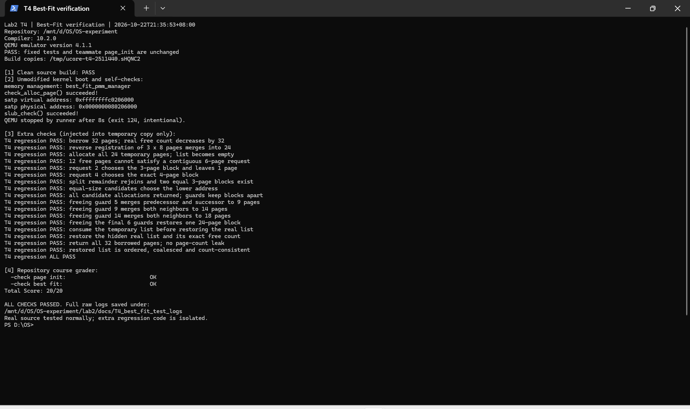

# T4：实现 Best-Fit 连续物理内存分配算法

**负责人：** 2511440-张博翔

Best-Fit 会从所有足够大的空闲块中，选择页数最少的一块。例如申请 2 页时，若有 5、3、4 页的空闲块，就选择 3 页块，分出 2 页，剩余 1 页仍放回空闲链表。

## 实现方法

空闲链表按起始地址排序，每个节点对应一个空闲块的头页。头页的 `property` 保存块的页数，`PG_property` 表示它是空闲块头；`nr_free` 记录空闲页总数。

- `best_fit_init()`：建立空链表，空闲页数清零。
- `best_fit_init_memmap()`：检查可用页范围，初始化描述符，将这段页面登记为空闲块，按地址插入并合并相邻块。
- `best_fit_alloc_pages()`：遍历链表，保留长度最小且能满足申请的候选。遇到长度恰好等于申请页数的块即可停止。选中后摘除原块，必要时建立剩余块，更新标记及空闲页数。
- `best_fit_free_pages()`：清理归还页面的状态和引用计数，建立新空闲块，按地址插入，与前后相邻块合并。
- `best_fit_nr_free_pages()`：返回空闲页总数。

上述函数通过 `best_fit_pmm_manager` 注册到框架。`pmm.c` 的 `init_pmm_manager()` 默认选择它，所以通用的 `alloc_pages()`、`free_pages()` 实际调用的是 Best-Fit。

## 本次调整

小组仓库原来已有 Best-Fit 实现，但默认启用树形 Buddy。本次在已有实现上统一了地址有序插入和合并逻辑，让初始化登记与页面回收共用一个辅助函数，支持逆序登记相邻可用段；增加描述符范围和可检测的重叠检查，并清理分配、合并后失效的块头标记与长度。

默认管理器切换为 Best-Fit。原有 Buddy 代码保留，可通过 `PMM_USE_LIST_BUDDY` 或 `PMM_USE_TREE_BUDDY` 选择；两个宏不能同时定义。队友负责的 `page_init()`、Buddy 和 SLUB 实现未改动，两个固定测试函数 `basic_check()`、`best_fit_check()` 也保持原样。

## 验证结果

验证时间为 2026-10-22，环境为 ReductWSL、GCC 10.2.0、QEMU 4.1.1 / OpenSBI v0.4。测试由助手执行并记录。

当前源码在隔离副本中重新编译，保留仓库原有的 `bin/`、`obj/`。未注入额外测试的内核运行输出包含：

```text
memory management: best_fit_pmm_manager
check_alloc_page() succeeded!
slub_check() succeeded!
```

这说明实际启用了 Best-Fit，管理器内置检查及后续 SLUB 自测均通过。

另一个隔离副本运行了额外回归，验证逆序登记相邻段、非精确最小适配、精确命中、碎片导致的连续分配失败、同尺寸块选择、拆分后的回收、前后双向合并，以及借出并归还 32 页后空闲页总数恢复。全部断言通过。额外测试只注入临时副本，不进入正式内核，也未修改固定测试。

项目自带 `make grade` 输出：

```text
  -check page init:                          OK
  -check best fit:                           OK
Total Score: 20/20
```

评分中的 10 分属于 `page_init`，10 分属于 Best-Fit 管理器选择检查；算法行为还由前面的内置检查及额外回归验证。正常启动测试在检查完成后由脚本于第 8 秒结束 QEMU，退出码 124 是预设超时，不是内核报错。



原始日志、源码哈希和复现脚本见 [T4_best_fit_test_logs](T4_best_fit_test_logs/README.md)。首次实现版本的四段式提示词见 [T4_best_fit_prompt.md](T4_best_fit_prompt.md)。

## 是否还有改进空间？

有。目前查找最合适的块，最坏需要遍历全部 `k` 个空闲块，时间复杂度为 `O(k)`。精确命中时提前停止只能减少部分遍历，不能改变最坏复杂度。

可以额外维护按“块大小、起始地址”排序的平衡树，用 `lower_bound(n)` 找到长度至少为 `n` 的最小块，查找为 `O(log k)`。同时保留按地址排序的索引，方便释放时定位相邻块。分配、拆分和合并都要同步更新两种索引，代价是额外的内存和维护工作。仅维护一个最大空闲块长度，只能快速排除部分失败申请，不能直接找到最小足够块。

Best-Fit 仍可能产生难以利用的小碎片。改进查找速度不能消除外部碎片，本次采用链表实现，便于理解和验证。
