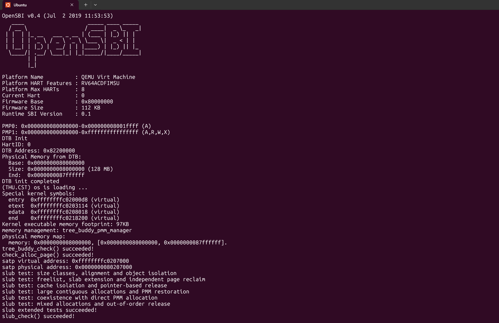

# 实验报告

## 实验基本信息

| 项目 | 内容 |
|------|------|
| **实验名称** | Lab 2: 物理内存与页表 |
| **小组成员** | 2512075-詹力臻、2511440-张博翔、2511794-宋昕睿 |
| **完成日期** | 2026-10-25 |

### 小组分工

练习如何分工？

| 成员 | 负责的练习与实现 |
|------|----------------|
| 2511794-宋昕睿 | 功能模块一：实现物理内存探测与页描述符初始化功能；Challenge：硬件的可用物理内存范围的获取方法；分支任务 gdb 调试 |
| 2511440-张博翔 | 功能模块二：理解 First-Fit 连续物理内存分配算法；实现 Best-Fit 连续物理内存分配算法 |
| 2512075-詹力臻 | 功能模块二：buddy system（伙伴系统）分配算法；Challenge：任意大小的内存单元 slub 分配算法 |


实验报告如何分工？

报告内容按同样的范围分工。

---

## 一、实验目的

<!-- 说明本次实验的主要目标和预期成果 -->

本实验的主要目的是：

1. 理解内核如何取得物理内存范围，并从中排除固件、内核和管理数据已经占用的页面。
2. 掌握 `struct Page`、空闲块链表和 `pmm_manager` 的关系，读懂 First-Fit，并实现 Best-Fit 和 Buddy System。
3. 在页分配接口之上实现简化的 SLUB，理解页分配与小对象分配各自解决的问题。

---

## 二、实验环境

你们使用的 AI 工具

| 成员 | AI 编程工具 | 底层模型 | 备注 |
|------|------------|---------|------|
| 2512075-詹力臻 | Codex | GPT-6 sol | 无 |
| 2511440-张博翔 | Codex | GPT-5.6 sol | 无 |
| 2511794-宋昕睿 | DeepSeek Harness、Codex | DeepSeek v4.1 flash、GPT-5.6 Terra | 无 |

**说明：**
- **AI 编程工具**：指具体使用的终端工具、编辑器插件、桌面应用或浏览器界面
- **底层模型**：指该工具使用的大语言模型及版本

---

## 三、实验整体逻辑分析

### 3.1 本章节的逻辑主线

Lab2 的核心是建立一个从地址映射到内存资源分配的基本管理体系。主要解决两个问题：一是如何通过页表建立虚拟地址到物理地址的映射，使内核能够正确访问物理内存；二是如何识别和管理可用物理内存，并根据程序的需求分配和释放内存。

在此基础上，实验进一步研究如何组织和分配物理内存。不同分配算法面对的是相同的物理内存资源，但采用不同的管理策略；而 SLUB 则在页分配器之上继续细化分配粒度，使系统能够高效地处理小于一页的内存请求。

### 3.2 功能的逐步实现

1. **建立地址映射与物理内存管理基础。** 内核需要能够正确访问物理内存，并区分已占用与可用的物理页面。因此，首先理解页表、物理内存布局和 Page 描述符，为后续分配器提供正确的内存范围与管理对象。

2. **理解并实现物理页分配机制。** 在明确可管理的物理内存范围后，需要解决连续页面如何分配、释放与回收的问题。

3. **实现 Buddy System，并探索不同的数据结构。** Buddy System 利用二次幂大小的内存块及固定的伙伴关系完成分裂与合并。在此基础上进一步实现显式二叉树版本，可以比较链表与树对同一分配机制的不同表达方式。

4. **实现 SLUB 小对象分配器。** 页级分配无法直接满足细粒度的小内存请求，因此需要在页面内部进一步划分对象。SLUB 通过 cache 和 slab 管理固定大小的对象，并在整张 slab 不再被使用时将页面归还 PMM。

5. **完成 GDB 页表查询分支任务。** 在理解分页机制的基础上，通过调试实际观察地址转换过程，将理论上的页表查询与内核执行状态对应起来，验证对地址映射机制的理解。

---

## 四、实验内容与实现

<!--
说明：本部分按照 exercises 文档中的练习顺序组织
每个功能模块或者练习中可能包含多项任务，请根据实际情况调整
-->

### 功能模块一：物理内存初始化功能

#### 任务一：实现物理内存探测与页描述符初始化功能

**负责人：** 2511794-宋昕睿

**任务：** 实现 `kern/mm/pmm.c` 中的 `page_init()`，建立物理页描述符布局，并把真正可用的完整页面交给当前管理器。

```c
static void page_init(void);
```

`page_init()` 不接收参数，也不返回结果。它通过 `get_memory_base()` 和 `get_memory_size()` 取得设备树解析结果，设置 `va_pa_offset`、`npage` 和 `pages`，最后调用 `init_memmap()` 注册空闲页。

**实现过程。** 先设置 `va_pa_offset = PHYSICAL_MEMORY_OFFSET`，因为后续的 `PADDR()` 需要这个偏移。读取内存信息后，基址或长度为零、基址低于 `DRAM_BASE` 时直接 `panic`。正常情况下，内存末端取设备树报告值与框架上限的较小值，并向下按页对齐。

随后把描述符数组放到内核镜像结束位置之后。这里要区分页号上界和页数：`npage` 是物理页号上界，数组长度为 `npage - nbase`，`pages[i]` 对应的物理页号为 `nbase + i`。描述符先全部置为 Reserved，避免尚未完成布局的页被提前分配。

关键计算为：

```c
npage = ROUNDDOWN(mem_end, PGSIZE) / PGSIZE;
pages = (struct Page *)ROUNDUP((uintptr_t)end, PGSIZE);
size_t nr_desc = npage - nbase;
uintptr_t free_start = ROUNDUP(PADDR(pages + nr_desc), PGSIZE);
uintptr_t free_end = npage * PGSIZE;
if (free_start < free_end) {
    init_memmap(pa2page(free_start), (free_end - free_start) / PGSIZE);
}
```

`pages` 本身是描述符数组的虚拟地址；`PADDR(pages + nr_desc)` 才是数组结束位置的物理地址。空闲区从它向上页对齐后开始，因此内核和描述符数组都不会被登记为空闲页。若已经没有完整页面，则不调用 `init_memmap()`。

内存范围为 `[0x80000000, 0x88000000)`，`end = 0xffffffffc020720c`。结合当前 `struct Page` 布局可以算出：

| 项目 | 地址或大小 |
|------|-----------|
| 描述符数组虚拟起点 `pages` | `0xffffffffc0208000` |
| 描述符数组物理起点 | `0x80208000` |
| 描述符数量 | `0x88000 - 0x80000 = 32768` |
| 每个描述符大小 | 40 字节 |
| 数组占用 | `32768 × 40 = 0x140000`，即 1.25 MiB |
| 可分配区间 | `[0x80348000, 0x88000000)` |
| 初始可用页数 | 31928 页 |


#### 最终提示词：
````markdown
[PROMPT]
任务：在 riscv64-ucore Lab2 的 kern/mm/pmm.c 中，从预留骨架实现 static void page_init(void)，完成物理内存探测、Page 描述符初始化与可用页注册。请直接修改实际文件，保留 lab2 注释并将 YOUR CODE 替换为 2511794。只补齐本函数，不改 pmm_init、init_memmap、其他分配器或固定测试。

[RELY]
请先阅读 kern/mm/pmm.c、pmm.h、memlayout.h、mmu.h、kern/driver/dtb.h 和 libs/defs.h，以工程中的真实定义为准，不重复定义已有宏和结构。
- PGSIZE=4096，PGSHIFT=12；DRAM_BASE=0x80000000；PHYSICAL_MEMORY_END=0x88000000；PHYSICAL_MEMORY_OFFSET=0xffffffff40000000。
- nbase=DRAM_BASE/PGSIZE。pages、npage、va_pa_offset 已在 pmm.c 定义；end 为 extern char end[] 链接符号。
- struct Page 的字段为 ref、flags、property、page_link；SetPageReserved 与 set_page_ref 使用框架实现。
- get_memory_base()/get_memory_size() 返回 DTB 解析结果；可调用 panic、cprintf、init_memmap 和 pa2page。
- PADDR(kva) 检查内核地址后减 va_pa_offset；pa2page(pa) 返回 pages + PPN(pa) - nbase。
- ROUNDUP/ROUNDDOWN 使用 typeof(a)，end 需先转 uintptr_t 再参与按页取整。

[GUARANTEE]
必须补齐接口：static void page_init(void);
不修改其函数签名，不新增另一套 Page 数组或内存分配公共接口。

[SPECIFICATION]
## page_init
Pre-Condition：dtb_init 和 init_pmm_manager 已运行；DTB 信息可能有效也可能无效；入口已建立内核高地址映射。
Post-Condition：正常返回后，va_pa_offset、物理页号上界 npage、按页对齐的描述符数组 pages 正确；只有排除启动保留区、内核镜像、描述符数组后的完整页面被登记为空闲。虚拟地址、物理地址、页号和 Page* 不得混用。
Case 1：内存基址、长度非零，且基址不低于 DRAM_BASE。先设置偏移，读取并校验内存信息；令 mem_end=min(base+size, PHYSICAL_MEMORY_END)，npage=ROUNDDOWN(mem_end,PGSIZE)/PGSIZE。pages=ROUNDUP((uintptr_t)end,PGSIZE)，数组长度为 npage-nbase；逐项清零 flags/property/ref 并设置 Reserved。free_start=ROUNDUP(PADDR(pages+(npage-nbase)),PGSIZE)，free_end=npage*PGSIZE。仅在 free_start<free_end 时，调用 init_memmap(pa2page(free_start),(free_end-free_start)/PGSIZE)。输出实际探测范围。
Case 2：基址或长度为零、基址低于 DRAM_BASE。panic 终止，不继续建立描述符数组或登记空闲页；已经设置的偏移无需撤销。
Case 3：有效范围中没有剩余完整页。保留描述符的 Reserved 状态，不以零页数调用 init_memmap。
Requirements：不得把描述符个数写为 npage；不得把内核和数组存储区登记为空闲；空闲起点向上、末端向下按页对齐。输出当前源码的编译与运行结果，不预先填写通过。集成测试需在 Best-Fit 模块补齐后进行，不修改两个固定测试来绕过编译错误。
````

**遇到的问题与处理。** `ROUNDUP(end, PGSIZE)` 曾报 `cast specifies array type`。原因是宏使用 `typeof(a)`，而 `end` 声明为 `char[]`；改为先转换到 `uintptr_t` 后，宏中的类型转换才合法。

**验证。** 运行输出成功识别 128 MiB 内存，当前管理器完成 `check_alloc_page()`； `check page init` 通过。

#### Challenge：硬件的可用物理内存范围的获取方法

**负责人：** 2511794-宋昕睿

**问题：** 操作系统从哪里获得可用物理内存范围？

通常由固件或引导程序向内核提供内存布局，内核再结合区域用途和自身占用情况，确定可以分配的范围。内存映射表不能只记录“总共多少内存”，还需要能区分起始地址、长度和区域类型，避免把设备窗口、固件保留区等当作普通内存。

传统 x86 BIOS 启动环境中，引导程序可以循环调用 `INT 15h / EAX=E820h`，取得各段内存的起始地址、长度和类型，再把结果传给内核。即使某段标为可用，内核也要扣除内核镜像、启动信息、管理结构等已占用部分，最后只注册完整页面。

本实验的 RISC-V 路径使用设备树：入口保存 OpenSBI 传来的 DTB 地址，`dtb_init()` 验证头部魔数，解析 `memory` 节点的 `reg` 属性，保存内存基址和长度，之后由 `page_init()` 读取并完成布局。

```text
entry.S 保存 boot_dtb
    → dtb_init / extract_memory_info
    → get_memory_base / get_memory_size
    → page_init
    → init_memmap
```

两种方法传递信息的形式不同，目的相同：先弄清哪些物理地址能够用，再决定哪些已经可以分配。本工程的 DTB 解析器只处理实验所需的简化内存描述，没有实现真实系统中多内存区间、全部保留表、NUMA 或热插拔管理。

### 功能模块二：物理内存分配功能

#### 任务一：理解 First-Fit 连续物理内存分配算法（思考题）

**负责人：** 2511440-张博翔

**任务：** 结合 `default_init()`、`default_init_memmap()`、`default_alloc_pages()`、`default_free_pages()`，说明初始化、连续页分配、回收与合并过程，并分析改进空间。

```c
static void default_init(void);
static void default_init_memmap(struct Page *base, size_t n);
static struct Page *default_alloc_pages(size_t n);
static void default_free_pages(struct Page *base, size_t n);
```


空闲链表连接的是每个空闲块头页中的 `Page.page_link`。一个节点代表一段连续空闲页，并不是把这段中的每一页都分别挂入链表。头页的 `property` 记录块长，`PG_property` 表示它是空闲块头；`nr_free` 是空闲页总数，不是块数。

`default_init()` 建立空链表并清零计数。`default_init_memmap(base, n)` 将已经确认可用的连续页面初始化，清理状态和引用计数，由头页保存长度，增加 `nr_free`，再按起始地址顺序插入链表。这些操作修改的是描述符，不会搬动物理页中的数据。

`default_alloc_pages(n)` 从链表头查起，找到第一个长度至少为 n 的块就停止。分配该块前 n 页；若有余页，就以 `page + n` 为新头页建立剩余块，放回原来的位置。空闲页数减少 n，被分配头页的空闲标志清除。若所有块都太小，即使空闲总量足够也返回 `NULL`。

`default_free_pages(base, n)` 将归还页面登记成一个空闲块，按地址插入，再检查前后相邻块。前块起点加长度等于本块起点时，可以并入前块；更新块头后，再检查能否接上后块。被吞并的旧块头应摘下节点并清除头标志。合并只改变表示方式，不再增加 `nr_free`。

例如，P100～P101 和 P104～P106 原本空闲，归还 P102～P103 后，三个相邻块可以合成从 P100 开始的 7 页块。页数不变，链表中的节点从三个变为一个。

**是否还有改进空间？** 有，搜索和检查都可以改进。

当前选块最坏需要遍历 k 个空闲块。可以按地址建立平衡搜索树，每个节点保存本块长度 `len`，并维护该子树最大空闲块长度：

```text
max_len = max(本块 len, 左子树 max_len, 右子树 max_len)
```

申请 n 页时先看左子树：若 `max_len < n`，整棵左子树都可以跳过；否则优先到左边找。左边没有合适块才检查本节点和右子树，因此仍保留 First-Fit 选择地址最前面合适块的规则。树平衡时，选块搜索可降到 `O(log k)`。分配、拆分、合并和树旋转后都要更新相关节点的最大值，代价是额外字段和维护代码。仅维护一个全局最大块长度，只能快速判断一部分失败请求，不能直接找到第一个合适块。逐页清理描述符的工作也不会因此消失。


**代码阅读发现。** 当前 First-Fit 源码在非空链表尾部插入后缺少退出循环的 `break`，可能再次访问刚插入节点并重复插入。应在完成尾插后退出，或抽成插入完成即返回的辅助函数。

#### 任务二：实现 Best-Fit 连续物理内存分配算法

**负责人：** 2511440-张博翔

**任务：** 在不修改两个固定测试函数的前提下补齐完整管理模块，定义 `best_fit_pmm_manager`，并在 `init_pmm_manager()` 中实际选用它。

```c
static void best_fit_init(void);
static void best_fit_init_memmap(struct Page *base, size_t n);
static struct Page *best_fit_alloc_pages(size_t n);
static void best_fit_free_pages(struct Page *base, size_t n);
static size_t best_fit_nr_free_pages(void);
```

**实现。** 空闲链表仍按地址排列，以便释放时合并；分配策略则从“第一个足够大”改为“所有足够大的块中最小的一个”。若空闲块分别为 5、3、4 页，申请 2 页时选 3 页块，而不会直接使用第一个 5 页块。遇到恰好满足的块就可以停止查找。

选中块后，先保存长度和原链表位置，摘除头节点；有余页时建立剩余块并放回原位置。分配头页清除 `PG_property`，长度置零，`nr_free` 只减少实际申请的 n 页。

初始化登记与释放共用 `best_fit_insert_and_merge()`：先按地址找到插入位置，检查与前后块是否重叠，插入一次，再依次检查前驱和后继是否紧邻。被并入大块的旧头页清除标记、长度和链接。这样也能处理多个可用内存段按逆序登记、登记后相邻可合并的情况。

`best_fit_pmm_manager` 将上述函数与 `best_fit_check` 注册到统一接口。默认选择设为 Best-Fit，同时保留链表 Buddy 和树 Buddy 的编译选择路径。固定的 `basic_check()`、`best_fit_check()` 保持原样。

#### 最终提示词
````markdown
[PROMPT]

我正在完成 riscv64-ucore Lab2 的“实现 Best-Fit 连续物理内存分配算法”任务。请先阅读项目中的实际代码，再直接修改文件，不能只在回答中给出代码。

源码修改范围只有两个文件：

1. `kern/mm/best_fit_pmm.c`：在标有 `lab2` 和 `YOUR CODE` 的位置实现完整的 Best-Fit 管理模块。实验骨架只提供 `basic_check()` 和 `best_fit_check()`，内部状态、五个管理函数和 `best_fit_pmm_manager` 注册结构需要自行补齐。
2. `kern/mm/pmm.c`：在 `init_pmm_manager()` 中将默认管理器切换为 `best_fit_pmm_manager`，使内核运行时实际使用并检查 Best-Fit。

参考 `kern/mm/default_pmm.c` 的 First-Fit 实现以及 `pmm.h` 的接口约定，沿用项目现有的页描述符、双向链表和断言工具。实验代码标记使用 `//lab2 function2-2 2511440`。不要修改 `basic_check()`、`best_fit_check()` 的任何内容，也不要修改其他同学负责的物理内存探测、Buddy、SLUB 或评分脚本。

实现采用按地址排序的空闲块链表。Best-Fit 的选择规则是：在所有长度不小于申请页数的空闲块中，找出长度最小的块；找到恰好满足需求的块可以提前结束遍历。请把地址有序插入和前后邻块合并写成一个公共辅助函数，让初始化登记和释放页面共用。

[RELY]

以仓库中的实际声明为准，重点阅读以下文件：

- `kern/mm/pmm.h`：物理内存管理器接口和公共分配、释放接口。
- `kern/mm/memlayout.h`：`struct Page`、状态位和 `free_area_t`。
- `libs/list.h`：双向链表操作。
- `kern/mm/default_pmm.c`：完整的 First-Fit 参考实现。
- `kern/mm/best_fit_pmm.c`：待完成骨架以及两个不可修改的测试函数。
- `kern/mm/pmm.c`：当前管理器选择方式及 `page_init()` 对管理器的调用方式。

`pmm_manager` 的接口为：

```c
struct pmm_manager {
    const char *name;
    void (*init)(void);
    void (*init_memmap)(struct Page *base, size_t n);
    struct Page *(*alloc_pages)(size_t n);
    void (*free_pages)(struct Page *base, size_t n);
    size_t (*nr_free_pages)(void);
    void (*check)(void);
};
```

框架中的 `alloc_pages()`、`free_pages()` 和 `nr_free_pages()` 会转发到当前 `pmm_manager`。因此，只实现文件而不切换管理器，不能完成这项任务。

页描述符包含以下成员：

```c
struct Page {
    int ref;
    uint64_t flags;
    unsigned int property;
    list_entry_t page_link;
};

typedef struct {
    list_entry_t free_list;
    unsigned int nr_free;
} free_area_t;
```

每个 `Page` 描述一个物理页。链表中只挂各个空闲块头页的 `page_link`，不是把块内所有页面逐个挂入链表。头页的 `property` 表示这个块包含多少个连续页，`PG_property` 表示该页是空闲块头页。

使用项目已有的 `PageReserved()`、`PageProperty()`、置位和清位宏、`set_page_ref()`、`le2page()`，不要重复定义它们。注意 `list_add(head, elm)` 插在 `head` 后面，`list_add_before(head, elm)` 插在 `head` 前面；删除节点后可用 `list_del_init()` 使其自环。

测试会直接保存、替换和恢复空闲链表及计数。实现必须提供以下内部状态；骨架若没有定义，就自行新增，若已有则保留且不要重复定义：

```c
static free_area_t free_area;
#define free_list (free_area.free_list)
#define nr_free (free_area.nr_free)
```

这两个宏必须仍可作左值使用，不能改为只读函数。物理页描述符数组的有效范围根据实际框架确定，本项目为 `[pages, pages + (npage - nbase))`。

[GUARANTEE]
必须实现并注册以下管理接口；辅助函数与内部状态按实际需求增加：
```c
static void best_fit_init(void);
static void best_fit_init_memmap(struct Page *base, size_t n);
static struct Page *best_fit_alloc_pages(size_t n);
static void best_fit_free_pages(struct Page *base, size_t n);
static size_t best_fit_nr_free_pages(void);
extern const struct pmm_manager best_fit_pmm_manager;
```
保留框架 basic_check()、best_fit_check() 并将后者用于管理器的 check 回调。


请保证以下约束：

1. `basic_check()` 和 `best_fit_check()` 逐字保留；不要删断言、改预期结果或通过改测试让实现通过。
2. 只修改上述两个源码文件。不要改动 `page_init()`，不要改 Buddy、SLUB 或评分器。
3. `free_list` 始终按空闲块起始地址升序排列。每个空闲块内部的物理页连续，各块之间不重叠；不同空闲块之间可以隔着已经分配的页面。
4. 只在空闲块头页设置 `PG_property` 和有效的块长度；块内其他页的 `PG_property` 清零，`property` 为 0。被分配的页面不能继续带有空闲块头标记。
5. `nr_free` 始终等于链表中所有空闲块的 `property` 之和。两个物理相邻的空闲块要及时合并；合并只改变表示方式，不重复增减空闲页计数。
6. 分配失败返回 `NULL`，空闲链表、页状态和计数均保持不变。不能因为空闲页总数足够，就忽略是否存在足够大的连续空闲块。
7. 在登记和释放页面时检查 `n > 0`、起始描述符属于有效数组、剩余描述符数量不少于 `n`。先检查长度，再形成 `base + n`。按前后邻块的范围检查可检测的空闲区间重叠，避免将同一段空闲区间重复插入链表。
8. 断言和状态位只能发现部分非法释放，不要声称它们能够替代完整的分配记录，或检测所有重复释放和错误指针。
9. 若 `pmm.c` 已有 Buddy 的条件选择路径，保留这些路径，使没有选择宏时默认运行 Best-Fit；不要引入原项目不存在的 Buddy 头文件。若同时提供多种 Buddy 选择宏，冲突组合应在编译时报错。
10. 不新增平衡树等复杂结构，先完成符合框架约定的链表实现。测试和截图必须来自实际运行，不能编造通过结果。

[SPECIFICATION]

### 1. 定义管理函数和公共辅助函数

实现以下五个函数，可以另外增加 `static` 辅助函数：

```c
static void best_fit_init(void);
static void best_fit_init_memmap(struct Page *base, size_t n);
static struct Page *best_fit_alloc_pages(size_t n);
static void best_fit_free_pages(struct Page *base, size_t n);
static size_t best_fit_nr_free_pages(void);
```

公共辅助函数负责把一个已经设置好头页长度的空闲块插入链表，再合并前后相邻块：

- 找到第一个起始地址不小于 `base` 的后继，确定前驱。
- 插入前，检查前驱的结束位置不超过本块起点、本块结束位置不超过后继起点。
- 按地址插入一次；若前驱与本块相邻，合并到前驱，并把合并后的前驱作为当前块。
- 再检查当前块与后继是否相邻，若相邻则继续合并。
- 被吞并的旧头页清除 `PG_property`，将 `property` 置 0，并从链表摘除，避免留下失效标记和链接。
- 该辅助函数不修改 `nr_free`，页数只由调用它的登记或释放函数增加一次。

### 2. `best_fit_init()`

初始化 `free_list` 为表头自环的空链表，将 `nr_free` 设为 0。

### 3. `best_fit_init_memmap(base, n)`

`page_init()` 调用它登记一段可分配的连续页面，调用前这些页面应处于 Reserved 状态。

- 完成范围检查，并逐页断言 `PageReserved(p)`。
- 逐页清理 `flags`、`property` 和引用计数，初始化链表节点。
- 令 `base->property = n`，只给头页设置 `PG_property`。
- `nr_free` 增加 `n`，调用公共辅助函数插入并合并。
- 支持分多次登记物理相邻的可用范围；登记顺序不必按地址升序，也不能因此留下相邻却分开的空闲块。

### 4. `best_fit_alloc_pages(n)`

- 断言 `n > 0`。若 `n > nr_free`，直接返回 `NULL`。
- 遍历空闲链表，在 `property >= n` 的候选中保留最小块。遇到 `property == n` 时立即停止；大小相同可以保留最先找到的块。
- 如果没有候选，返回 `NULL` 且不修改状态。
- 找到候选后先保存原块长度和原链表位置，再摘除该块。
- 若原块大于 `n`，从 `base + n` 建立剩余块，长度为原长度减 `n`，设置新头页标记，并放回原位置，保持地址有序。
- 清除被分配头页的 `PG_property`，把它的 `property` 置 0，使被分配的页面不再表示空闲块；不要改动属于剩余块的新头页。
- `nr_free` 减少 `n`，返回原块头页。分配区间的引用计数保持框架要求的初始值 0。

### 5. `best_fit_free_pages(base, n)`

- 完成范围检查，逐页检查页面既非 Reserved，也不是空闲块头页。
- 清理这段描述符的状态、长度、引用计数和链表节点。
- 设置 `base->property = n` 和头页标记，`nr_free` 增加 `n`。
- 调用公共辅助函数，完成地址有序插入、可检测的重叠检查及前后合并。
- 同时邻接前后两个空闲块时，最终合成一个块，只有最前面的头页保留长度与头标记。

### 6. `best_fit_nr_free_pages()` 与注册

`best_fit_nr_free_pages()` 返回 `nr_free`。定义：

```c
const struct pmm_manager best_fit_pmm_manager = {
    .name = "best_fit_pmm_manager",
    .init = best_fit_init,
    .init_memmap = best_fit_init_memmap,
    .alloc_pages = best_fit_alloc_pages,
    .free_pages = best_fit_free_pages,
    .nr_free_pages = best_fit_nr_free_pages,
    .check = best_fit_check,
};
```

注意 `best_fit_check` 的声明顺序：可以把注册结构放在测试函数后，也可以添加不改变测试函数内容的 `static` 前向声明。

在 `pmm.c` 中包含已有的 Best-Fit 头文件，并使 `init_pmm_manager()` 默认设置 `pmm_manager = &best_fit_pmm_manager`。保留项目原有的初始化、输出和可选管理器路径。

### 7. 验证与交付

实现完成后先检查源码差异，确认两个框架测试没有变化，且修改范围符合要求。若仓库跟踪了 `bin/`、`obj/` 等编译产物，可以将当前源码复制到隔离测试目录构建，避免把无关产物带入提交。

- 编译内核，处理与本次修改有关的错误。
- 启动 QEMU，确认实际输出的管理器名称为 `best_fit_pmm_manager`，内置页面分配检查成功，并核对后续 SLUB 检查及是否出现断言或 panic。
- 运行项目提供的 `make grade`，记录真实评分和退出状态。若环境缺少依赖或某项失败，保留错误并说明原因，不能写成通过。
- 在验证通过后截取真实运行窗口，截图要能看清管理器名称和检查结果，保存为 `lab2/docs/T4_best_fit_test_result.png`；同时保存原始测试日志，便于核对。
- 将本提示词保存为 `lab2/docs/prompts/best_fit_prompt.md`。汇报修改内容、验证结果和交付物位置，不自动提交或推送仓库。
````

**验证。** 内核输出 `memory management: best_fit_pmm_manager` 和 `check_alloc_page() succeeded!`。额外回归覆盖：逆序相邻内存段登记、2 页请求选 3 页块、4 页精确命中、空闲总数足够但没有连续 6 页时失败、同尺寸块选择、拆分后回收、同时合并前后块，以及归还借用页面后计数恢复。

**Best-Fit 是否还有改进空间？** 目前查找最小足够块仍是 `O(k)`。可以另建一棵按“块长、起始地址”排序的平衡树，用 `lower_bound(n)` 在 `O(log k)` 时间内找到最小足够块，再保留地址索引用于释放合并。拆分和合并必须同步更新两个索引，因此会增加元数据和维护成本。精确命中时提前结束能减少部分搜索，但不改变最坏复杂度；Best-Fit 也仍可能留下难以利用的小碎片。

#### 任务三：Buddy System 物理页分配算法

负责人： 2512075-詹力臻

模块功能描述

Buddy System 是一种连续物理页分配算法，将空闲内存组织成大小为 $2^k$ 页的块。分配时通过拆分较大的空闲块满足请求，释放时寻找真正的伙伴块并逐级合并。本模块通过现有 pmm_manager 接口接入内核，使 Buddy System 能够替代其他物理内存分配策略，而不需要修改上层公共分配接口。

需要实现/修改的函数
```c
void buddy_init(void);
void buddy_init_memmap(struct Page *base, size_t n);
struct Page *buddy_alloc_pages(size_t n);
void buddy_free_pages(struct Page *base, size_t n);
size_t buddy_nr_free_pages(void);
void buddy_check(void);
```
核心函数与算法

- buddy_init()： 初始化各阶空闲链表和空闲页计数。每一阶对应一种块大小，块头通过 Page.property 记录块大小，并通过页面状态标记识别空闲块。

- buddy_init_memmap()： 初始化可用页面的描述符，并将连续空闲区划分为满足大小和物理页号对齐要求的 Buddy block。初始空闲区不一定恰好构成一个合法的大块，因此需要根据剩余长度和起始物理页号逐步划分。

- buddy_alloc_pages()： 将请求页数向上取整至最小的二次幂，寻找对应阶的空闲块；若不存在，则从更高阶取得大块并逐级分裂。空闲页计数减少的是实际分配的块大小，而不是原始请求页数。

- buddy_free_pages()： 根据分配时相同的规则确定实际块大小，并寻找对应的伙伴块。只有大小相同且确实互为伙伴的空闲块才能合并，合并后继续向更高阶检查。

- buddy_nr_free_pages()： 返回当前实际空闲的物理页总数。

- buddy_check()： 提供分配器的检查入口，由独立测试 Prompt 补充专项测试。

- Buddy System 的关键在于区分物理相邻的块与真正互为伙伴的块。对于大小为 $s=2^k$ 页、起始物理页号为 $p$ 的合法块，其伙伴页号可以通过以下关系确定：`peer_ppn = p ^ s;`该关系依赖块的物理页号对齐条件。只有两个块属于同一个父块，才能合并为大小为 $2s$ 的块。若仅根据物理地址相邻就进行合并，可能破坏更大块所需的对齐条件，导致后续分配与合并出现错误。

Buddy System 的优势是伙伴定位和合并规则明确，能够逐级恢复较大的连续空闲块；不足是非二次幂请求需要向上取整，例如申请 5 页实际占用 8 页，从而产生内部碎片。

必须合并两个由同一个块分裂出来的原因是：如果随意合并相邻块，可能导致最后无法完善的合并成一个完整的块。

#### 最终提示词

````markdown
[PROMPT]

**任务**：
在现有 ucore 物理内存管理框架中实现 Buddy System 物理页分配模块，并接入现有 `pmm_manager`。

**操作要求**：
- 只能在实验项目 lab2/code 下进行操作
- 必须直接修改项目中的实际文件。
- 保留已有代码和已有分配算法。
- 只修改 Buddy System 实现和接入所需的内容。
- 按照 `git` 的规范进行工作，保持修改范围清晰，使用户可以通过 Git 检查和回退本次修改；未经用户明确要求，不主动回退或覆盖已有修改。

**输出要求**：
- 完成 Buddy System 模块实现并接入内核。
- 使用工程中真实存在的类型、宏和接口。
- 保证项目能够正常编译和运行。
- 本 Prompt 主要负责 Buddy System 的实现；完整的专项测试将在后续测试 Prompt 中补充。


[RELY]

Buddy System 可以依赖现有物理内存管理框架。

主要相关内容：

1. **struct Page**：`code/kern/mm/memlayout.h`
```c
    struct Page {
        int ref;                        // page frame's reference counter
        uint64_t flags;                 // array of flags that describe the status of the page frame
        unsigned int property;          // the num of free block, used in first fit pm manager
        list_entry_t page_link;         // free list link
    };
```

2. **struct pmm_manager**：`code/kern/mm/pmm.h`
```c
    struct pmm_manager {
        const char *name;
        void (*init)(void);
        void (*init_memmap)(struct Page *base, size_t n);
        struct Page *(*alloc_pages)(size_t n);
        void (*free_pages)(struct Page *base, size_t n);
        size_t (*nr_free_pages)(void);
        void (*check)(void);
    };
```
3. **已有 PMM 实现与注册方式**

`code/kern/mm/default_pmm.c` 中通过以下形式提供物理内存管理器：
```c
    const struct pmm_manager default_pmm_manager = {
        .name = "default_pmm_manager",
        .init = default_init,
        .init_memmap = default_init_memmap,
        .alloc_pages = default_alloc_pages,
        .free_pages = default_free_pages,
        .nr_free_pages = default_nr_free_pages,
        .check = default_check,
    };
```
现有 `pmm.c` 通过当前 `pmm_manager` 统一调用物理内存管理接口。

4. **list**：`code/libs/list.h`

链表节点：
```c
    struct list_entry {
        struct list_entry *prev, *next;
    };
```
可用链表操作包括：
```c
    list_init
    list_add
    list_add_before
    list_add_after
    list_del
    list_del_init
    list_empty
    list_next
    list_prev
```
已有 `default_pmm.c` 和 `best_fit_pmm.c` 可以作为模块组织、Page 状态维护和 `pmm_manager` 接入方式的参考。


[GUARANTEE]

必须实现 Buddy System 对应的物理内存管理接口：

    void buddy_init(void);
    void buddy_init_memmap(struct Page *base, size_t n);
    struct Page *buddy_alloc_pages(size_t n);
    void buddy_free_pages(struct Page *base, size_t n);
    size_t buddy_nr_free_pages(void);
    void buddy_check(void);

并提供对应的 `pmm_manager` 实例。

具体函数是否需要声明为 `static`，以及头文件与管理器实例的组织方式，应根据工程现有 PMM 模块的实际组织方式确定。

允许增加必要的：
- static 辅助函数
- 模块内部状态
- 内部数据结构和宏

不得修改现有公共物理内存管理接口的函数签名。


[SPECIFICATION]

## Buddy System 整体行为

**Post-Condition**:
- 可用物理页被组织成大小为 2 的幂的 Buddy block。
- 能够完成 block 的分配、分裂、释放和伙伴合并。
- 对外保持现有物理内存管理接口语义。
- 对于大小为 `2^k` 页的合法 Buddy block，其起始物理页号必须满足 `2^k` 页对齐，使伙伴关系可以由物理页号的二进制关系唯一确定。


## buddy_init_memmap

**Pre-Condition**:
- `base` 指向连续空闲物理页的起始位置。
- `n > 0`。

**Post-Condition**:
- `[base, base+n)` 的所有页面都被纳入 Buddy System 管理。
- 这些页面被组织成一个或多个合法的 Buddy block。
- 不遗漏、不重复管理页面。
- 每个大小为 `2^k` 页的 block，其起始物理页号必须能够被 `2^k` 整除。
- 当整个初始空闲区不能直接构成单个合法 Buddy block 时，应划分为多个满足大小和物理页号对齐要求的合法 block。


## buddy_alloc_pages

**Pre-Condition**:
- `n > 0`。

**Post-Condition**:
- 成功时返回能够容纳至少 `n` 页的连续物理块。
- 当 `n` 不是 2 的幂时，应分配能够容纳 `n` 页的最小合法 Buddy block。
- 必要时能够从更大的 Buddy block 分裂得到所需 block。
- 分裂产生的所有 block 仍需满足对应大小的物理页号对齐要求。
- 无法满足请求时返回 `NULL`，且不破坏已有状态。
- 空闲页数量应减少实际被占用的 Buddy block 页数，而不是仅减少请求的 `n`。


## buddy_free_pages

**Pre-Condition**:
- `base` 对应此前成功分配的内存块。
- `n > 0`，并与此前的分配请求相匹配。

**Post-Condition**:
- 释放后的 block 重新变为空闲状态。
- 当原请求不是 2 的幂时，释放时必须采用与分配时一致的 Buddy block 大小。
- 空闲页数量应恢复实际被释放的 Buddy block 页数。
- 若其真正的伙伴 block 同样空闲，应进行合并。
- 合并后若新的 block 仍存在可合并伙伴，应继续向更大的 block 合并。
- 不能仅因为两个 block 在物理地址上相邻就进行合并。
- 真正的伙伴关系应建立在相同 block 大小、正确物理页号对齐和二进制伙伴关系之上，可以利用物理页号的二进制性质确定唯一 Buddy


## buddy_nr_free_pages

**Post-Condition**:
- 返回当前 Buddy System 中实际空闲的物理页总数。
- 返回值应与初始化、分配和释放过程中实际 Buddy block 的页数变化保持一致。


## buddy_check

**Post-Condition**:
- 保留符合 `pmm_manager` 接口要求并能够正常编译、调用的检查入口。
- 完整的 Buddy System 专项测试逻辑由后续独立的测试 Prompt 补充。
````

**验证提示词：**

````markdown
[PROMPT]

**任务**：
针对项目中已经实现的 Buddy System 物理页分配模块设计并实现专项测试。

**操作要求**：
- 必须读取当前项目中的真实 Buddy System 实现。
- 主要新增或完善测试，不重写 Buddy System 主体实现。
- 若测试发现实现错误，先明确指出失败场景和原因，不直接大规模重构算法。
- 必须直接修改项目中的实际测试代码。
- 保留已有测试。

**输出要求**：
- 测试能够随内核编译和运行。
- 覆盖 Buddy System 的核心行为和边界情况。
- 测试结束后恢复测试前的可用内存状态。
- 给出测试结果，并指出是否发现实现缺陷。

[RELY]

当前工程已经存在：

    buddy_pmm_manager
    buddy_init
    buddy_init_memmap
    buddy_alloc_pages
    buddy_free_pages
    buddy_nr_free_pages
    buddy_check

测试前请读取当前真实实现以及 `struct Page`、`struct pmm_manager` 和现有 PMM 测试代码。

[GUARANTEE]

主要完善：

    buddy_check(void)

可以根据需要增加本模块内部的 static 测试辅助函数。

不得改变 Buddy System 的公共接口。

[SPECIFICATION]

## Buddy System 测试

测试至少覆盖：

- 1、2、4 等 2 的幂页数分配；
- 3、5 等非 2 的幂请求，并验证实际占用块大小正确；
- 大块向小块的多级分裂；
- 真正伙伴块释放后的合并；
- 连续多级伙伴合并；
- 相邻但不是伙伴的块不能错误合并；
- 内存不足时分配失败且状态不被破坏；
- 不同分配之间不存在重叠；
- `nr_free_pages()` 与实际分配/释放的 Buddy block 大小一致；
- 测试结束后的空闲页总数与测试开始前一致。

对与物理页号对齐相关的行为，应验证大小为 `2^k` 页的合法 Buddy block 起始物理页号满足相应对齐关系。
````

**测试结果：**


专项测试覆盖以下核心行为：1、2、4 页等二次幂请求；3、5 页等非二次幂请求；大块分裂与多级伙伴合并；相邻非伙伴块；分配失败后的状态保持；分配区间不重叠；物理页号对齐；以及测试前后空闲页总数恢复。

这些测试分别检查分配大小取整、伙伴定位、状态维护和资源回收，可以发现错误合并、重复分配、计数不一致以及页面泄漏等问题。

#### 补充：基于显式二叉树的 Tree Buddy System

在完成链表版 Buddy System 后，我进一步尝试使用显式二叉树实现相同的伙伴分配机制。与原实现通过不同阶的空闲链表组织内存块不同，树形实现直接记录每个区间的状态，包括不可用、空闲、已分裂和已分配，并通过递归完成分配、释放与合并。

实现过程中，一个关键问题是初始空闲区不一定是二次幂大小，也不一定与树的区间边界完全对齐。因此，需要支持对部分区间进行递归划分，只将完全属于可用内存范围的节点标记为空闲。释放时则沿树定位对应节点，只有同一父节点下的两个子区间都空闲时才向上合并。

通过这次尝试，我进一步理解了 Buddy System 的核心约束与数据结构之间的区别：伙伴分配规则决定哪些内存块可以合并，而链表或显式二叉树决定如何组织和维护这些状态。 树形实现也让我更直观地理解了内存块的分裂层级，以及相邻区间不一定互为伙伴的原因。

#### 提示词

````markdown
请在当前 `lab2/code` 中额外实现一个基于显式二叉树/线段树的 Buddy System，用来和现有 Buddy 实现做对比。

必须不能做的事情：
- 不能修改或覆盖现有 `buddy_pmm.c/.h`。
- 不能修改现有 First-Fit、Best-Fit、PMM 公共接口。
- 不能在 `lab2/code` 之外进行操作。

必须完成的事情：
- 新增一个独立的线段树/显式树版 Buddy System，并接入现有 `pmm_manager`。
- 支持物理页初始化、连续页分配、释放、空闲页统计和基本检查。
- 非 2 的幂请求要分配能够容纳它的最小 2 的幂 block。
- 初始可管理页数不一定是 2 的幂，也要正确管理，不能直接丢掉剩余页面。
- 释放时只有真正互为 buddy 的块才能合并，并支持向上连续合并。
- 完成后编译并运行基本测试。

实现方法：
- 使用显式二叉树或线段树表示物理页区间。
- 每个树节点表示一个连续的 Buddy block，并维护该 block 当前是空闲、已分裂还是已占用等必要状态。
- 分配时在树上寻找能够满足请求的最小块，必要时向下分裂。
- 释放时恢复对应节点，并在两个子块都空闲时向上合并。
- 具体接口、宏、Page 定义和工程接入方式请自行阅读当前项目代码后确定。
````

#### Challenge：任意大小的内存单元 SLUB 分配算法

#### 负责人： 2512075-詹力臻

#### 模块功能描述

页分配器以 4 KiB 为单位管理物理内存，直接使用整页满足几十字节的请求会造成空间浪费。SLUB 在现有页分配接口之上建立小对象分配层，将页面划分为多个固定大小的 object，并通过不同的 cache 管理不同尺寸的对象。

#### 需要实现/修改的函数
```c
void slub_init(void);
void *slub_alloc(size_t size);
void slub_free(void *ptr);
void slub_check(void);
```
#### 功能说明

- slub_init()： 初始化各个 size class 对应的 cache 和管理链表，但不预先申请物理页。

- slub_alloc()： 根据请求大小选择合适的 cache，优先从已有 slab 的空闲对象链表中分配；没有可用对象时，向底层 PMM 申请新页面并初始化 slab。超出小对象管理范围的请求通过底层页分配接口处理。

- slub_free()： 根据对象指针定位其所在页面，恢复对应 slab 和 cache 的管理信息，将对象放回空闲链表。当 slab 中不再存在已分配对象时，将整张页面归还 PMM。

- slub_check()： 提供基本检查及专项测试入口。

SLUB 的核心是通过 cache、slab 和 freelist 管理不同分配粒度。每个 cache 管理相同大小的 object，每张 slab 对应一张页面；空闲对象利用自身空间保存链表指针，而被分配的对象空间则交给调用者使用。SLUB 只依赖公共页分配接口，因此不需要了解底层使用的是哪一种 PMM 算法。

#### 最终提示词
````markdown
[PROMPT]

**任务**：
在现有 ucore 内存管理框架中实现一个简化的 SLUB 小对象内存分配模块，并接入现有内核。

**操作要求**：
- 只能在实验项目 `lab2/code` 下进行操作。
- 必须直接修改项目中的实际文件。
- 保留已有 PMM 和 Buddy System 实现。
- SLUB 应建立在现有页分配接口之上，不依赖某一种具体 PMM 算法的内部实现。
- 只修改 SLUB 实现和接入所需内容。
- 按照 git 规范保持修改范围清晰，允许用户自行检查和回退。

**输出要求**：
- 完成 SLUB 模块实现和必要接入。
- 使用工程中真实存在的类型、宏和接口。
- 保证项目能够正常编译运行。
- 实现阶段允许进行必要的基本自检和运行验证；完整专项测试由后续独立 Prompt 完成。


[RELY]

1. 现有物理页分配接口：`code/kern/mm/pmm.h`

    struct Page *alloc_pages(size_t n);
    void free_pages(struct Page *base, size_t n);
    size_t nr_free_pages(void);

2. 页面大小和地址对齐相关定义：`code/kern/mm/mmu.h`

包含：

    PGSIZE
    PGSHIFT

等相关定义。

3. 链表接口

链表节点：

    struct list_entry {
        struct list_entry *prev, *next;
    };

可用链表操作包括：

    list_init
    list_add
    list_add_before
    list_add_after
    list_del
    list_del_init
    list_empty
    list_next
    list_prev

其他所需的地址转换、Page 描述符和辅助接口，应直接读取当前工程中的真实定义后使用，不自行假设不存在的 API。


[GUARANTEE]

必须实现 SLUB 所需的主要接口：

    [slub_init]
    [slub_alloc]
    [slub_free]
    [其他实际需要暴露的接口]

允许增加必要的：
- cache 数据结构
- slab metadata
- static 辅助函数
- 模块内部状态和宏

不得修改现有公共 PMM 接口的函数签名。


[SPECIFICATION]

## SLUB 整体行为

**Post-Condition**:
- 在现有页分配器之上提供小于页面粒度的对象分配能力。
- 对小内存请求，在没有合适空闲 object 时，可以申请新的物理页并将其中可用区域划分为若干等大的 object。
- 一张物理页作为一个 slab，由对应 cache 管理。
- 每个 cache 管理固定大小的 object。
- 本模块主要负责小于一页的对象分配；对于当前 slab size class 无法容纳的请求，可以根据现有 PMM 接口采用合理处理方式，但不得破坏 SLUB 小对象管理语义。


## SLUB 初始化

**Post-Condition**:
- 各 size class 对应的 cache 被正确初始化。
- 初始时不必预先占用物理页。


## 对象分配

**Pre-Condition**:
- 请求大小合法。

**Post-Condition**:
- 请求被映射到能够容纳它的合适大小 object。
- 优先从已有 slab 的空闲 object 中分配。
- 若当前 cache 没有可用 object，则从底层 PMM 申请新的 page 并初始化为 slab。
- slab 所在页面保持页对齐；slab 内各 object 的起始地址满足正确的内存对齐要求。
- 空闲 object 可以利用自身空间维护 freelist，而被分配后的整个 object 空间可供调用者使用。


## 对象释放

**Pre-Condition**:
- `ptr` 为此前由 SLUB 成功分配的 object 起始地址。

**Post-Condition**:
- 根据 `ptr` 所在页面恢复其所属 slab 和 cache。
- object 被重新加入对应 slab 的空闲结构。
- 当 slab 中不存在已使用 object 时，将该 slab 从 cache 中移除，并把整张 page 归还底层 PMM。
- SLUB 不依赖底层 PMM 的具体分配算法。


## slab 与 cache 管理

**Post-Condition**:
- 一个 cache 可以管理多张 slab。
- 每张 slab 记录足以支持 object 分配、释放和整页回收的状态。
- slab metadata 与 object 区域不能重叠。
- object 区域满足正确的地址对齐要求。


## slub_check

**Post-Condition**:
- 保留可正常编译调用的测试入口。
- 完整专项测试不要求在本次实现中完成。
````
#### 测试提示词
````markdown
[PROMPT]

**任务**：
针对 `lab2/code` 中已经实现并接入内核的简化 SLUB 分配器设计并实现一组独立的专项测试，用于验证其对象分配、释放、slab 扩展与回收、大对象处理以及与底层 PMM 的交互是否正确。

当前 SLUB 已经能够通过基本 `slub_check()`，本次任务需要在此基础上设计更完整的测试，而不是重新实现 SLUB。

**操作要求**：
- 只能在实验项目 `lab2/code` 下进行操作。
- 必须先阅读当前真实的 `kern/mm/slub.c`、相关头文件和调用位置，理解实际接口、size class、slab 布局和大对象处理方式。
- 主要新增或完善测试逻辑，不重写 SLUB 主体实现。
- 不修改 Buddy System、First-Fit、Best-Fit 等 PMM 实现。
- 如果测试失败，首先判断问题来自测试代码还是 SLUB 实现，并明确说明失败场景和原因。
- 未确认 SLUB 主体存在缺陷前，不得对其进行大规模修改。
- 按照 git 规范保持修改范围清晰，允许用户自行检查和回退。

**输出要求**：
- 完成 SLUB 专项测试并直接修改实际项目文件。
- 保证项目能够正常编译和在 QEMU 中运行。
- 明确报告每类测试覆盖的行为以及最终结果。
- 测试结束后必须恢复测试前的内存状态，不得因为测试永久占用物理页。


[RELY]

当前工程中已经存在：

- `kern/mm/slub.c`
- `slub_init`
- `slub_alloc`
- `slub_free`
- `slub_check`

当前实现具有以下基本语义：

- SLUB 建立在现有 PMM 页分配接口之上。
- 一张 slab 使用一张物理页。
- 同一 slab 中的 object 大小固定。
- 空闲 object 利用自身空间组成 freelist。
- 一个 cache 可以管理多张 slab。
- 当一张 slab 中所有 object 都被释放后，该 slab 对应的整张物理页会归还底层 PMM。
- 较大的内存请求通过现有页分配接口处理。
- SLUB 不依赖 Buddy System 的内部实现。

底层物理页接口包括：

    struct Page *alloc_pages(size_t n);
    void free_pages(struct Page *base, size_t n);
    size_t nr_free_pages(void);

页面大小和地址相关定义以当前工程中的真实 `PGSIZE`、`PGSHIFT` 及相关宏为准。

测试前必须读取当前 `slub.c` 的真实实现，不要自行假设：
- size class 的具体取值；
- slab header 大小；
- object 对齐方式；
- 大对象阈值；
- 大对象 metadata 的具体布局。


[GUARANTEE]

主要完善当前 SLUB 的专项测试入口：

    slub_check

允许根据测试需要增加：
- static 测试辅助函数；
- 临时测试数组；
- 断言；
- 必要的调试输出。

不得改变：
- `slub_alloc` 和 `slub_free` 的公共接口；
- PMM 的公共接口；
- Buddy System 主体实现。

如果发现 SLUB 实现确有缺陷，应先给出能够稳定复现该缺陷的测试，再进行最小范围修复。


[SPECIFICATION]

## 测试整体要求

**Pre-Condition**:
- PMM 已完成初始化。
- SLUB 已完成初始化。
- 基本的页分配与释放功能可正常工作。

**Post-Condition**:
- 所有测试均完成后，`nr_free_pages()` 应恢复到测试开始前的值。
- 测试期间产生的所有 SLUB 对象和底层物理页必须被正确释放。
- 不同有效分配之间不得发生内存重叠。
- 测试不得破坏后续内核运行状态。


## 不同大小对象分配

验证多个不同大小的小对象请求。

测试应覆盖：
- 很小的对象；
- 位于某个 size class 边界附近的对象；
- 跨越不同 size class 的对象；
- 接近 SLUB 小对象上限的对象。

需要验证：
- 每次分配均返回有效地址；
- 返回地址满足当前实现规定的对齐要求；
- 不同同时存活的对象空间不发生重叠；
- 对象能够正常写入和读取。


## 同一 cache 的连续分配

对属于同一 size class 的请求连续进行多次分配。

需要验证：
- 多个对象可以从同一 slab 中正常取得；
- 返回的 object 地址不同；
- 每个 object 的数据互不干扰；
- freelist 状态不会导致重复分配仍在使用的 object。


## freelist 释放与复用

分配多个同一大小 object，释放其中部分对象，再进行新的同尺寸分配。

需要验证：
- 被释放 object 能重新进入空闲结构；
- 后续分配可以合理复用空闲 object；
- 尚未释放的 object 不得被重复返回；
- 释放和再次分配不会破坏其他对象中的数据。


## 多 slab 扩展

对同一个 cache 连续申请足够多的 object，使单个 slab 无法容纳全部对象。

需要验证：
- 当已有 slab 没有空闲 object 时，会从底层 PMM 获取新的 page 并建立新的 slab；
- 多张 slab 可以同时存在并正常提供 object；
- 所有返回 object 互不重叠；
- 底层空闲物理页数量出现符合 slab 扩展行为的变化。


## slab 整页回收

创建至少一张实际使用中的 slab，并最终释放其中全部 object。

需要验证：
- slab 中仍存在已使用 object 时，不能提前归还整张 page；
- 最后一个 object 被释放后，空 slab 可以从 cache 中移除；
- 对应 page 被归还给底层 PMM；
- `nr_free_pages()` 能反映整页归还。


## 多张 slab 的独立回收

构造同一 cache 下至少两张 slab。

需要验证：
- 清空其中一张 slab 时，只回收该 slab；
- 另一张仍含有效 object 的 slab 继续正常工作；
- 不能因为同属一个 cache 而错误释放仍在使用的 page。


## 不同 cache 之间的隔离

同时申请属于不同 size class 的对象。

需要验证：
- 不同 cache 的 slab 和 freelist 状态彼此独立；
- 释放一个 cache 中的 object 不影响另一个 cache 中仍然有效的 object；
- 不同大小对象中的数据互不破坏。


## 地址恢复与释放

针对小对象释放路径进行验证。

需要验证：
- `slub_free(ptr)` 能够由合法 object 指针恢复其所属 slab；
- 能够进一步识别正确的 cache；
- object 被归还到正确的 freelist；
- page 内存在多个 object 时，释放其中一个不会误回收整张 slab。


## 大对象请求

根据当前实现实际定义的大对象阈值构造超过小对象管理范围的请求。

需要验证：
- 大对象能够通过底层页分配机制正确获得连续内存；
- 分配结果能够正常读写；
- 大对象释放后，其占用的底层物理页能够恢复；
- 大对象路径不会破坏已有小对象 cache/slab 状态；
- 不要在测试中硬编码 Buddy System 的内部页数取整规则，应以当前 SLUB 和 PMM 的真实接口语义为准。


## 混合分配与释放

混合执行：
- 不同大小的小对象分配；
- 多 slab 分配；
- 大对象分配；
- 非顺序释放。

需要验证：
- 所有存活对象的数据保持正确；
- 分配区间互不重叠；
- 中间释放不会破坏其他对象；
- 全部释放后物理页总数恢复。


## 内存状态恢复

测试开始时记录：

    size_t free_before = nr_free_pages();

完成所有测试并释放所有对象后验证：

    nr_free_pages() == free_before

若不相等，应定位仍被占用的 slab、大对象或测试自身遗漏的释放，而不是直接修改 PMM。


## 测试结果

测试全部通过时应输出明确标志，例如：

    slub extended tests succeeded!

如果测试失败：
- 输出或保留能够定位失败类别的信息；
- 判断属于测试预期错误、测试资源清理错误还是 SLUB 实现缺陷；
- 修复后重新进行完整编译和 QEMU 验证。
````
#### 测试结果

SLUB 专项测试覆盖不同大小对象的分配与对齐、freelist 释放与复用、多 slab 扩展、空 slab 回收、不同 cache 隔离、大对象分配、与直接 PMM 分配共存，以及混合分配和非顺序释放。


## 分支任务

### 分支任务：使用 GDB 调试 QEMU 的页表查询过程

**负责人：** 【2511794-宋昕睿】

**题目：** 用"双重 GDB"同时调试 ucore 与运行它的 QEMU 4.1.1：先在 qemu 源码中找到地址翻译的关键调用路径与分支，再通过条件断点停在一个确定会被访问的地址上，单步观察 TLB 查询与三级页表遍历，说明一个虚拟地址如何被翻译成物理地址；并对比未开分页（Bare）时的调用路径，说明 QEMU 模拟的 TLB 与真实 CPU 的 TLB 在逻辑上的区别。

> 说明：下文的源码行号对应本机 `qemu-4.1.1` 的调试版构建（`~/build-qemu-4.1.1-dbg`），不同版本会有漂移，函数名才是稳定坐标。

#### 一、调试架构：两个 GDB 各管一层

| 窗口 | 调的是什么 | 手段 | 能看到的符号 |
| --- | --- | --- | --- |
| T1 | QEMU 进程本体（里面装着 ucore） | `make debug`（带 `-s -S`） | 只是"现场"，基本不操作 |
| T2 | **x86 gdb**，attach 到 QEMU **进程** | `sudo gdb` → `attach <PID>` | QEMU 的 C 源码：`env / addr / i / pte / pte_addr` |
| T3 | **riscv gdb**，经 `:1234` 连 QEMU 的 gdbstub | `make gdb` | ucore 的符号与 riscv 寄存器：`kern_init / $pc / $sp / $satp` |

记法：**T3 制造访存，T2 观察翻译，T1 只是跑道。**

两者互不干扰的关键：T2 通过 ptrace 停在 QEMU 的任意 C 语句上；T3 通过 gdbstub 停在 riscv 指令上。T2 一旦命中，整个 QEMU 进程被冻结，T3 的命令会"卡住"——这是正常现象，不是死机。


#### 二、三窗口时序

```bash
# T1
cd /mnt/e/OS/RISCV/labcode/lab2
make debug QEMU=/home/asus/build-qemu-4.1.1-dbg/riscv64-softmmu/qemu-system-riscv64

# T2
pgrep -fa qemu-system-riscv64          # 会有两行：make 父进程 + qemu 子进程，attach 后者
sudo gdb
```

```gdb
set pagination off
attach <PID>
handle SIGPIPE nostop noprint
break get_physical_address if addr == 0xffffffffc0205ff8
continue
```

```bash
# T3
make gdb
```

```gdb
set pagination off
set remotetimeout unlimited
b *0xffffffffc02000ee
c
```

`handle SIGPIPE nostop noprint` 是必须的：qemu 会向管道/串口写数据，gdb 默认把 SIGPIPE 视为停止信号，不加这一句就会"`continue` 之后立刻又停、刷屏"，整个双 gdb 调试根本无法进行。

#### 四、被观测的那次访存是怎么选的

本机构建下：`kern_init = 0xffffffffc02000d8`，`kern_init+22 = 0xffffffffc02000ee` 处是一条 `sd ra,8(sp)`。在 T3 里核对：

| 命令 | 观察结果 |
| --- | --- |
| `x/i $pc` | `=> 0xffffffffc02000ee <kern_init+22>: sd ra,8(sp)` |
| `p/x $sp` | `0xffffffffc0206ff0` |
| `p/x $sp+8` | `0xffffffffc0206ff8` ← T2 条件断点里必须写这个**数据地址** |
| `p/x $satp` | `0x8000000000080204`（MODE=8 → Sv39） |

这里有一个容易踩的坑：条件断点要写**被访问的数据地址**，不是这条指令的取指地址。`sd ra,8(sp)` 的指令地址是 `…00ee`，它访问的地址是 `…6ff8`，`get_physical_address` 收到的是后者。

T3 执行 `si` 之后卡住，说明 T2 已经命中。

#### 五、关键调用路径（调试要求 1）

T2 命中后执行 `bt 3`：

```
#0  get_physical_address   target/riscv/cpu_helper.c:155
#1  riscv_cpu_tlb_fill     target/riscv/cpu_helper.c:435
#2  tlb_fill               accel/tcg/cputlb.c:878
```

完整链路（自底向上）：

| 层 | 文件:行 | 函数 | 作用 |
| --- | --- | --- | --- |
| softmmu 慢路径入口 | `accel/tcg/cputlb.c:878` | `tlb_fill()` | TLB 未命中后由生成的访存代码调用 |
| 架构实现 | `target/riscv/cpu_helper.c:435` | `riscv_cpu_tlb_fill()` | RISC-V 的 tlb_fill，取出 `satp` 决定按哪种模式翻译 |
| 页表遍历 | `target/riscv/cpu_helper.c:155` | `get_physical_address()` | **核心**：三级遍历 + 权限检查 + 算物理地址 |
| 回填 TLB | `target/riscv/cpu_helper.c:472` | `tlb_set_page()` | 把这次翻译结果写回 TLB 表 |

`tlb_fill` 在栈上出现，恰好证明了这条路径的语义：**只有未命中才会走到这里**。

#### 六、关键分支语句（调试要求 1）

| 位置 | 代码 | 含义 |
| --- | --- | --- |
| `:171` | `if (mode == PRV_M \|\| !MMU)` | M 模式或未启用 MMU：直接按物理地址返回 |
| `:183–202` | 按 `satp.MODE` 选 `levels/ptidxbits/ptesize` | Sv39 → 3/9/8；Bare（MBARE）在 `:196` |
| `:237` | `for (i = 0; i < levels; i++)` | 逐级遍历循环 |
| `:238` | `idx = (addr >> …) & mask` | 取本级 VPN 索引 |
| `:242` | `pte_addr = base + idx * ptesize` | 算出页表项物理地址 |
| `:252` | `pte = ldq_phys(pte_addr)` | 读页表项（这一步就是"查页表"的访存） |
| `:256–288` | `V / R / W / X / U / A / D` 检查 | **关键分支**：不是叶子就继续下一级，是叶子就结束 |
| `:334` | `*physical = (ppn \| (vpn & mask)) << PGSHIFT` | PPN 与页内偏移拼成物理地址 |

两条最需要讲清的分支：

1. `pte & PTE_V == 0` → 翻译失败（非法映射）；
2. `pte & (PTE_R | PTE_W | PTE_X) != 0` → 本项是**叶子**，遍历在此结束；否则把 `base` 更新成该项的 PPN 段并进入下一轮。这也是为什么"中间级必须是 V=1 且 R/W/X 全 0"——否则它会变成一个提前结束的大页。

#### 七、单步一次完整的地址翻译（调试要求 2）

在 T2 里加上循环内断点：

```gdb
break cpu_helper.c:254 if addr == 0xffffffffc0205ff8
continue
p/x i
p/x ptshift
p/x idx
p/x pte_addr
p/x pte
finish
p/x pa
```

| 项 | 实测值 | 说明 |
| --- | --- | --- |
| `addr` | `0xffffffffc0205ff8` | 被访问的虚拟地址（store 的数据地址） |
| `access_type` | `1` | `MMU_DATA_STORE`（0=load、1=store、2=取指） |
| `env->satp` | `0x8000000000080204` | MODE=8（Sv39）、PPN=0x80204 → 根表物理地址 `0x80204000` |
| `i` | `0` | 当前是第 1 级（根级） |
| `ptshift` | `0x12` | 本级索引在虚拟地址中的移位量 |
| `idx` | `0x1ff` | = `VPN[2]`，即根表第 511 项 |
| `pte_addr` | `0x80204000 + 0x1ff*8 = 0x80205ff8` | 页表项自身的物理地址 |
| `pte` | `0x200000cf` | `V/R/W/X/A/D` 全 1 → **叶子，1 GiB 大页** |
| `pa` | `0x80206000` | 页对齐基址（低 12 位为 0） |

数值验算（这条链条能闭合，才算真的观测到了翻译）：

```
pte = 0x200000cf
  低 10 位 0x0cf = V|R|W|X|A|D  → 合法叶子，读写执行皆可
  PPN  = pte >> 10 = 0x80000    → 物理基址 0x80000 << 12 = 0x80000000
最终物理地址：
  (PPN | ((addr >> 12) & mask)) << 12 = (0x80000 | 0x206) << 12 = 0x80206000
  再或上页内偏移 (addr & 0xfff) = 0xff8  →  0x80206ff8
与"固定偏移"换算结果对照：
  addr - va_pa_offset = 0xffffffffc0206ff8 - 0xffffffff40000000 = 0x80206ff8   ✓ 一致
```

也就是说：QEMU 用软件走完一次页表遍历得到的物理地址，与内核里 `PADDR` 宏算出来的完全一致——这就从两条独立路径上同时验证了 Sv39 大页映射的正确性。

**关于"三个循环在做什么"**：源码里的遍历结构是 `:237` 的单层 `for (i = 0; i < levels; i++)`，每轮做三件事——按 `ptshift` 取本轮 VPN 索引、算出 `pte_addr`、`ldq_phys` 读出 `pte`，然后判断"叶子还是下一级"。若按三级页表的完整设计，Sv39 的 `levels = 3` 本应执行三轮，依次索引 `VPN[2]`、`VPN[1]`、`VPN[0]`。但本实验**只执行了一轮**（`i` 恒为 0），原因见下节。

#### 八、为什么 lab2 只走一级

`kern/init/entry.S` 建立的启动页表只有 1 个有效项：

```asm
.zero 8 * 511                  # 前 511 项全 0：V=0，未映射
.quad (0x80000 << 10) | 0xcf   # 第 511 项：1 GiB 大页，VRWXAD
```

所有 `0xffffffffc0…` 开头的地址，`VPN[2] = (VA >> 30) & 0x1ff` 都等于 `0x1ff`，正好落在第 511 项上；而该项的 `R/W/X` 非全 0，是**叶子**，于是第一轮就直接返回。第 2、3 级只有在"当前级不是叶子"时才会继续——换句话说，4 KB 页映射才会走到三级，1 GiB 大页一级就到底。

这也解释了 `memory: ...` 与 `satp` 打印里的现象：lab2 的内核只用了这一张"一项页表"，把整个 `[0xffffffffc0000000, 0xffffffffffffffff]` 映射到 `[0x80000000, 0xc0000000)`。

#### 九、TLB 查找的 C 代码在哪（调试要求 3）

结论先说：**QEMU 里没有"查 TLB"的独立 C 函数，命中路径断不到。**

原因：访存快路径是 TCG 在生成代码时**内联展开**的——对 `tlb_table` 按页号索引、比较 tag（`tlb_hit()` 之类的内联比较）这几条指令直接编进翻译块里，不经过任何 C 函数调用。因此：

| 路径 | 形态 | 能否断到 |
| --- | --- | --- |
| 命中 | TCG 生成的比较指令（内联） | 否（没有函数调用） |
| 未命中 | `tlb_fill` → `riscv_cpu_tlb_fill` → `get_physical_address` | 能 |
| 回填 | `tlb_set_page()`（`cpu_helper.c:472`） | 能 |
| 失效 | `sfence.vma` → `tlb_flush()` | 能 |

验证方法：在 T2 保持 `get_physical_address` 的条件断点，第一次命中后 `continue`——**同一页的后续访问不再命中**。这既证明 TLB 缓存生效，也证明命中确实不经过 C 代码。

#### 十、QEMU 的 TLB 与真实 CPU 的逻辑区别（调试要求 4）

对照实验：找一条**未开分页**时的访存。`kern_entry` 开头保存 hartid 的 `sd a0,0(t0)` 位于物理地址 `0x80200008`（此时 `satp = 0`）：

```gdb
# T2
condition 1 addr == 0x80208000
continue
```

```gdb
# T3
b *0x80200008
c
xi $pc
si
```

```gdb
# T2 命中后
p/x env->satp      # 0x0
next               # 走 MBARE 分支：*physical = addr; return
```

| 维度 | 未开分页（Bare） | 开启分页（Sv39） |
| --- | --- | --- |
| `env->satp` | `0x0` | `0x8000000000080204` |
| 翻译动作 | `*physical = addr` 原样返回 | 三级遍历 + 权限检查 |
| 是否读页表 | 否 | 是（`ldq_phys` 读 PTE） |
| 索引计算 | 不执行 | `VPN[2]/[1]/[0]` 逐级 |

由此可以回答"qemu 的 TLB 与真实 CPU 的 TLB 有什么逻辑区别"：

| 维度 | QEMU 模拟 | 真实 CPU |
| --- | --- | --- |
| 查找方式 | 翻译块里内联的软件比较（顺序比较少量 tag） | 硬件并行 CAM 比较，一拍出结果 |
| 表项结构与索引 | 定长数组、按虚拟页号直接索引（近似直接映射） | 组相联，硬件替换策略（LRU 等） |
| 填充 | 未命中时**软件**走页表，再 `tlb_set_page` 回填 | 硬件页表遍历器（PTW）自动填充 |
| 失效 | `sfence.vma` 触发**整体 flush**，粒度粗 | 支持按 ASID / 地址范围的精细失效 |
| ASID | 基本不参与匹配（近似忽略） | 按 ASID 区分地址空间，切换进程不必整体刷新 |
| 代价模型 | 与真实 TLB 容量、命中率无关 | 容量/组数/替换策略直接决定性能 |

一句话：**QEMU 保留的是"地址翻译的语义"，丢弃的是"TLB 的硬件行为"**——它不需要模拟容量、替换和并行性，只要保证翻译结果正确。

#### 十一、调试中值得记录的细节（调试要求 5）

| 现象 | 原因 | 解决 |
| --- | --- | --- |
| `continue` 后立刻又停、疯狂刷屏 | 没加 `handle SIGPIPE nostop noprint`，qemu 写管道触发信号 | 补上该命令 |
| T3 敲 `si` 之后卡住，以为模拟器死了 | T2 命中，整个 QEMU 进程被 ptrace 冻结 | 回 T2 `c`，T3 才会返回 |
| 条件断点永不命中 | 写成了指令地址 `…00ee`，而函数参数是数据地址 `…6ff8` | 用 `p/x $sp+8` 核对，写数据地址 |
| `No symbol "idx/pte_addr/pte"` | 还没进入 `for` 循环，局部变量尚未初始化 | `break cpu_helper.c:254` 断到循环体内 |
| `No symbol table is loaded` | 用了 strip 版 qemu（13 MB） | 换成 `~/build-qemu-4.1.1-dbg/…`（31 MB） |
| `ptrace: Operation not permitted` | WSL 下 `ptrace_scope=1` | `sudo gdb` |
| `attach` 后永远看不到 CPU 活动 | attach 到了 `make` 父进程或残留旧 qemu | `pgrep -fa` 选带 `-s -S` 的那个 PID |

最"抓马"的一条：一开始把条件断点写成指令地址，断点明明存在、`Enb=y`，却永远不命中，反复怀疑是 gdb 或 qemu 坏了。后来在 T3 里 `p/x $sp`、`p/x $sp+8` 才意识到 `get_physical_address` 的 `addr` 是**被访问的数据地址**，与指令自己的地址不是一回事——这也是"访问的地址才重要，哪条指令不重要"那句话的实证。

#### 十二、借助大模型解决的问题（调试要求 6）

| 情景 | 我问的问题 | 得到的答复 | 我的验证 |
| --- | --- | --- | --- |
| 不清楚为什么要两个 gdb | "调试正在运行 ucore 的 qemu 源码，是不是要两个 gdb？" | attach 进程调 qemu 源码 vs 连 gdbstub 调内核，两者机制不同，不能混用 | `bt` 里出现 `tlb_fill` 证明 T2 停在模拟器侧；T3 的 `x/i $pc` 显示的是 riscv 指令 |
| 不知道该断在哪 | "qemu 里和地址翻译有关的代码在哪，怎么开始？" | 从 `tlb_fill` → `riscv_cpu_tlb_fill` → `get_physical_address` 这条链找，断点打在 `get_physical_address` | grep 出 `cpu_helper.c:155`，下断点后 `bt` 与预期一致 |
| 断点命中量爆炸 | "断点每次都停，怎么只停在我要的地址？" | 用条件断点，把函数入参 `addr` 与目标地址比较 | 加 `if addr == …` 后一次跑到命中 |
| 不知道地址会不会变 | "学长文档里的地址和我的不一样，是不是错了？" | 偏移相同、基地址随内核版本变化，必须用 `nm`/`objdump` 现算 | `nm` 得到 `kern_init=0xffffffffc02000d8`，与手册中 `…004a` 不同但 `+22` 一致 |
| 为什么只走一级 | "三级页表为什么 `i` 一直是 0？" | 看 `entry.S` 的页表内容：只有第 511 项有效，且是 1 GiB 大页叶子 | 手算 `VPN[2] = (VA>>30)&0x1ff = 0x1ff`，与 `idx` 实测值一致 |

#### 十三、结论

1. **调用路径**：`tlb_fill`（`cputlb.c:878`）→ `riscv_cpu_tlb_fill`（`cpu_helper.c:435`）→ `get_physical_address`（`:155`）→ `tlb_set_page`（`:472`）。这条链只在 TLB 未命中时出现。
2. **关键分支**：`:171` 特权级/无 MMU 直接返回；`:183–202` 按 `satp.MODE` 决定 `levels/ptidxbits/ptesize`；`:237` 起逐级遍历；`:256–288` 用 `V` 与 `R/W/X` 判定"叶子还是下一级"；`:334` 拼出物理地址。
3. **一次实测翻译**：`sd ra,8(sp)` 访问 `0xffffffffc0206ff8`（`access_type=1`），`satp=0x8000000000080204`；根表第 511 项 `pte=0x200000cf` 是 1 GiB 叶子，故只走一级；`PPN=0x80000`，拼得页基址 `0x80206000`，加页内偏移 `0xff8` 得 `0x80206ff8`，与 `VA - va_pa_offset` 完全一致。
4. **TLB**：QEMU 的 TLB 命中判断由 TCG 内联生成，C 侧只可见未命中路径（`tlb_fill`）、回填路径（`tlb_set_page`）与失效路径（`sfence.vma` → `tlb_flush`）；未开分页时同一调用链在 MBARE 分支直接返回、不查页表。与真实 CPU 相比，QEMU 只保留翻译语义，不模拟 TLB 的容量、并行比较、替换策略与 ASID 精细失效。


## 六、实验总结与收获

### 对操作系统的理解

通过本次实验，我们理解了物理内存管理与虚拟内存机制的基本原理。页表负责建立虚拟地址与物理地址的映射，PMM 负责物理页面的分配与回收，不同分配器则针对不同的内存需求采用不同的管理策略。

同时，我们认识到，操作系统各模块之间存在明确的依赖关系，正确的内存管理不仅要求算法本身合理，还需要保证地址映射、资源状态和接口协作的正确性，并通过调试与测试进行验证。

### OS 原理中重要但本实验未覆盖的知识点

本实验主要涉及基础页表映射和物理内存分配，没有完整实现按需分页、页面置换、写时复制等虚拟内存机制，也没有深入处理多核环境下分配器的并发同步问题。这些机制进一步决定了操作系统如何在更复杂的运行环境中管理内存。

### AI 协作开发的经验

在这次实验过程中，深入体会了与 AI 协作的模式。并对于一直存在的“当 AI 能够输出大量代码的时候如何进行检查和验证”有了进一步的理解。其实发现，可以在 AI 工作前和 AI 工作后都进行检查：前者是写一个完善的 Prompt, 这一步个人认为更大的作用是逼迫协作者对项目有着非常完善的理解，控制 AI 运作的范围；后者是让不同会话的 AI 构建一个协作者明确要检查到的检查代码，进行验证。

不过，进一步思考，协作者做如此完善的规定是否有必要？在 AI 模型能力日益增强的时候，一些规定一些接口应该不需要协作者来写出来吧，尤其是项目不太大的时候。而我们也尝试了写一个比较简洁的提示词，去做一个关于 buddy system 的另一类写法，即利用线段树/二叉树，显示地构建父子关系，不需要内存下标对齐处理方式，也能很好实现（采取 GPT 6 sol high）。

---
