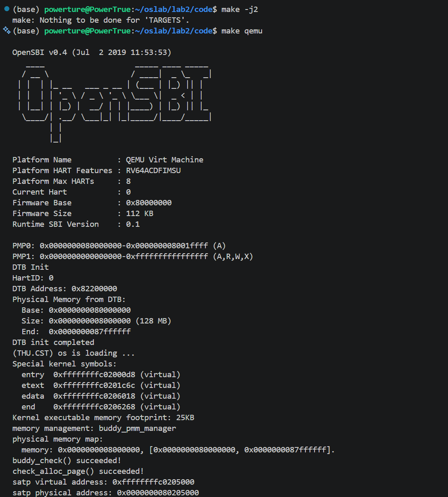

# 实验报告

## 实验基本信息

| 项目 | 内容 |
|------|------|
| **实验名称** | Lab 2：物理内存和页表 |
| **小组成员** | 2512075-詹力臻、2511440-张博翔、2511794-宋昕睿 |
| **完成日期** | 2026-10-24（报告整理） |
| **代码与测试记录** | 主要集成验证完成于 2026-10-22 |

### 小组分工

| 成员 | 负责的练习与实现 |
|------|----------------|
| 2511794-宋昕睿 | 功能模块一：实现物理内存探测与页描述符初始化功能；Challenge：硬件的可用物理内存范围的获取方法 |
| 2511440-张博翔 | 功能模块二：理解 First-Fit 连续物理内存分配算法；实现 Best-Fit 连续物理内存分配算法 |
| 2512075-詹力臻 | 功能模块二：buddy system（伙伴系统）分配算法；Challenge：任意大小的内存单元 slub 分配算法 |

报告内容按同样的范围分工：宋整理内存初始化及拓展问题，张整理 First-Fit、Best-Fit 的分析与验证，詹整理 Buddy System、SLUB。各项说明和测试结果在本报告中统一汇总。

## 一、实验目的

1. 理解内核如何取得物理内存范围，并从中排除固件、内核和管理数据已经占用的页面。
2. 掌握 `struct Page`、空闲块链表和 `pmm_manager` 的关系，读懂 First-Fit，并实现、比较 Best-Fit 和 Buddy System。
3. 在页分配接口之上实现简化的 SLUB，理解页分配与小对象分配各自解决的问题。
4. 通过内核断言、自测、课程评分和运行输出核对实现，练习用规格明确的提示词辅助开发。

## 二、实验环境

### 开发与运行环境

集成验证使用 Windows 上的 ReductWSL（Debian 13），通过 RISC-V 交叉工具链编译内核，再由 QEMU 模拟运行。小组各成员的本地目录可以不同，以下列出的是本报告集成测试的环境。

| 项目 | 版本或配置 |
|------|-----------|
| 交叉编译器 | `riscv64-unknown-elf-gcc` 10.2.0 |
| 调试器 | SiFive GDB 10.1 |
| 模拟器与固件 | QEMU 4.1.1，OpenSBI v0.4 |
| 模拟机器 | `virt`，RV64，默认物理内存 128 MiB |
| 页面大小 | 4 KiB |
| 页表模式 | Sv39，使用实验提供的启动页表 |
| 工程目录 | 源码在 `lab2/code`，报告在 `lab2/`，提示词在 `lab2/docs/prompts/` |

### AI 工具

下表按小组确认沿用 Lab1 的工具记录填写。

| 成员 | AI 编程工具 | 底层模型 | 备注 |
|------|------------|---------|------|
| 2512075-詹力臻 | Codex | GPT-5.6 sol | 代码生成与测试辅助 |
| 2511440-张博翔 | Codex | GPT-5.6 sol | 代码阅读、实现与验证辅助 |
| 2511794-宋昕睿 | DeepSeek Harness、Codex | DeepSeek v4.1 flash、GPT-5.6 Terra | 内存初始化与报告整理辅助 |

## 三、实验整体逻辑分析

### 3.1 本章节的逻辑主线

Lab1 让内核能够启动并输出信息，Lab2 接着解决内存怎样交给内核管理的问题。首先要知道机器有多少内存，再说明每个物理页的状态存在哪里，最后才能讨论分配策略。

本实验在入口汇编中建立启动 Sv39 映射。页表物理页号与 `MODE=8` 写入 `satp`，执行 `sfence.vma` 后，内核转到高地址继续运行。这是 Lab2 提供的分页启动代码；Lab1 的最小内核尚未建立这套页表。这里使用启动大页映射，还没有实现用户进程的多级页表管理或缺页处理。

设备树提供物理内存基址和大小，`page_init()` 负责布置描述符并划出可用区；`pmm_manager` 负责后面的分配与回收。First-Fit、Best-Fit 和 Buddy 都实现同一套接口，因此可以切换分配器，而不用让调用者了解每种算法的内部结构。SLUB 再利用这些页，提供小于一页的对象分配。

### 3.2 功能的实现顺序

```text
入口保存 hartid、DTB 地址，建立启动映射
    ↓
kern_init：清理 .bss，解析 DTB，初始化控制台
    ↓
pmm_init
    ├─ init_pmm_manager：选择并初始化分配器
    ├─ page_init：建立 Page 数组，登记可用页
    └─ check_alloc_page：调用当前管理器的检查函数
    ↓
打印启动页表的虚拟地址、物理地址
    ↓
slub_init → slub_check → 内核空转
```

这一顺序有实际依赖：没有 DTB 信息就不能确定管理范围；没有描述符和空闲区，分配器就无页可分；SLUB 又必须等页分配器能够工作后才可以申请 slab。相同的页分配接口也使我们能分别验证算法，再检查它们与上层对象分配器的配合。

## 四、实验内容与实现

### 功能模块一：物理内存初始化功能

#### 任务一：实现物理内存探测与页描述符初始化功能

**负责人：** 2511794-宋昕睿

**任务：** 实现 `kern/mm/pmm.c` 中的 `page_init()`，建立物理页描述符布局，并把真正可用的完整页面交给当前管理器。

```c
static void page_init(void);
```

`page_init()` 不接收参数，也不返回结果。它通过 `get_memory_base()` 和 `get_memory_size()` 取得设备树解析结果，设置 `va_pa_offset`、`npage` 和 `pages`，最后调用 `init_memmap()` 注册空闲页。

**实现过程。** 先设置 `va_pa_offset = PHYSICAL_MEMORY_OFFSET`，因为后续的 `PADDR()` 需要这个偏移。读取内存信息后，基址或长度为零、基址低于 `DRAM_BASE` 时直接 `panic`。正常情况下，内存末端取设备树报告值与框架上限的较小值，并向下按页对齐。

随后把描述符数组放到内核镜像结束位置之后。这里要区分页号上界和页数：`npage` 是物理页号上界，数组长度为 `npage - nbase`，`pages[i]` 对应的物理页号为 `nbase + i`。描述符先全部置为 Reserved，避免尚未完成布局的页被提前分配。

关键计算为：

```c
npage = ROUNDDOWN(mem_end, PGSIZE) / PGSIZE;
pages = (struct Page *)ROUNDUP((uintptr_t)end, PGSIZE);
size_t nr_desc = npage - nbase;
uintptr_t free_start = ROUNDUP(PADDR(pages + nr_desc), PGSIZE);
uintptr_t free_end = npage * PGSIZE;
if (free_start < free_end) {
    init_memmap(pa2page(free_start), (free_end - free_start) / PGSIZE);
}
```

`pages` 本身是描述符数组的虚拟地址；`PADDR(pages + nr_desc)` 才是数组结束位置的物理地址。空闲区从它向上页对齐后开始，因此内核和描述符数组都不会被登记为空闲页。若已经没有完整页面，则不调用 `init_memmap()`。

**最终集成版本的布局。** 根据 10 月 22 日正常启动日志，内存范围为 `[0x80000000, 0x88000000)`，`end = 0xffffffffc020720c`。结合当前 `struct Page` 布局可以算出：

| 项目 | 地址或大小 |
|------|-----------|
| 描述符数组虚拟起点 `pages` | `0xffffffffc0208000` |
| 描述符数组物理起点 | `0x80208000` |
| 描述符数量 | `0x88000 - 0x80000 = 32768` |
| 每个描述符大小 | 40 字节 |
| 数组占用 | `32768 × 40 = 0x140000`，即 1.25 MiB |
| 可分配区间 | `[0x80348000, 0x88000000)` |
| 初始可用页数 | 31928 页 |

这里的 `end` 来自启动日志，其余地址和页数按源码公式推导。宋先前用 First-Fit 单独验证时，内核结束于 `0xffffffffc0206078`，对应 31929 页；两组数据属于不同镜像。上表统一采用最终 Best-Fit 集成版本，不混用旧地址。

`[0x80000000, 0x80200000)` 是实验保留的启动区域，并不表示 OpenSBI 固件本身占满了 2 MiB。横幅报告的固件大小为 112 KiB。

**提示词。** 完整提示词见附录 A。原始材料将可用接口、前置条件、输出状态与三类输入情形分别列出；整理版补齐了原稿中留待读取源码的宏说明。

**遇到的问题与处理。** 宋提供的记录中，`ROUNDUP(end, PGSIZE)` 曾报 `cast specifies array type`。原因是宏使用 `typeof(a)`，而 `end` 声明为 `char[]`；改为先转换到 `uintptr_t` 后，宏中的类型转换才合法。

另一个问题是只完成此函数时，整个工程仍会因 Best-Fit 空骨架中的 `free_list`、`nr_free` 未定义而编译失败。这是其他源文件尚未补齐造成的编译依赖，并非内存布局计算出错。单项验证阶段曾临时补充内部状态定义，仍选用 First-Fit；完整 Best-Fit 接入后不再需要该临时处理。

**验证。** 运行输出成功识别 128 MiB 内存，当前管理器完成 `check_alloc_page()`；课程评分的 `check page init` 通过。普通启动没有实际触发无效 DTB、极小内存等全部异常输入，因此这些分支只说明源码中的处理方式，不把它们写成已经逐项运行过的测试。

#### Challenge：硬件的可用物理内存范围的获取方法

**负责人：** 2511794-宋昕睿

**问题：** 操作系统从哪里获得可用物理内存范围？

通常由固件或引导程序向内核提供内存布局，内核再结合区域用途和自身占用情况，确定可以分配的范围。内存映射表不能只记录“总共多少内存”，还需要能区分起始地址、长度和区域类型，避免把设备窗口、固件保留区等当作普通内存。

传统 x86 BIOS 启动环境中，引导程序可以循环调用 `INT 15h / EAX=E820h`，取得各段内存的起始地址、长度和类型，再把结果传给内核。即使某段标为可用，内核也要扣除内核镜像、启动信息、管理结构等已占用部分，最后只注册完整页面。

本实验的 RISC-V 路径使用设备树：入口保存 OpenSBI 传来的 DTB 地址，`dtb_init()` 验证头部魔数，解析 `memory` 节点的 `reg` 属性，保存内存基址和长度，之后由 `page_init()` 读取并完成布局。

```text
entry.S 保存 boot_dtb
    → dtb_init / extract_memory_info
    → get_memory_base / get_memory_size
    → page_init
    → init_memmap
```

两种方法传递信息的形式不同，目的相同：先弄清哪些物理地址能够用，再决定哪些已经可以分配。本工程的 DTB 解析器只处理实验所需的简化内存描述，没有实现真实系统中多内存区间、全部保留表、NUMA 或热插拔管理。

### 功能模块二：物理内存分配功能

#### 任务一：理解 First-Fit 连续物理内存分配算法（思考题）

**负责人：** 2511440-张博翔

**任务：** 结合 `default_init()`、`default_init_memmap()`、`default_alloc_pages()`、`default_free_pages()`，说明初始化、连续页分配、回收与合并过程，并分析改进空间。

```c
static void default_init(void);
static void default_init_memmap(struct Page *base, size_t n);
static struct Page *default_alloc_pages(size_t n);
static void default_free_pages(struct Page *base, size_t n);
```

这项是代码阅读题，分析范围由四个函数的职责和改进问题确定，没有另行生成新算法。

空闲链表连接的是每个空闲块头页中的 `Page.page_link`。一个节点代表一段连续空闲页，并不是把这段中的每一页都分别挂入链表。头页的 `property` 记录块长，`PG_property` 表示它是空闲块头；`nr_free` 是空闲页总数，不是块数。

`default_init()` 建立空链表并清零计数。`default_init_memmap(base, n)` 将已经确认可用的连续页面初始化，清理状态和引用计数，由头页保存长度，增加 `nr_free`，再按起始地址顺序插入链表。这些操作修改的是描述符，不会搬动物理页中的数据。

`default_alloc_pages(n)` 从链表头查起，找到第一个长度至少为 n 的块就停止。分配该块前 n 页；若有余页，就以 `page + n` 为新头页建立剩余块，放回原来的位置。空闲页数减少 n，被分配头页的空闲标志清除。若所有块都太小，即使空闲总量足够也返回 `NULL`。

`default_free_pages(base, n)` 将归还页面登记成一个空闲块，按地址插入，再检查前后相邻块。前块起点加长度等于本块起点时，可以并入前块；更新块头后，再检查能否接上后块。被吞并的旧块头应摘下节点并清除头标志。合并只改变表示方式，不再增加 `nr_free`。

例如，P100～P101 和 P104～P106 原本空闲，归还 P102～P103 后，三个相邻块可以合成从 P100 开始的 7 页块。页数不变，链表中的节点从三个变为一个。

**是否还有改进空间？** 有，搜索和检查都可以改进。

当前选块最坏需要遍历 k 个空闲块。可以按地址建立平衡搜索树，每个节点保存本块长度 `len`，并维护该子树最大空闲块长度：

```text
max_len = max(本块 len, 左子树 max_len, 右子树 max_len)
```

申请 n 页时先看左子树：若 `max_len < n`，整棵左子树都可以跳过；否则优先到左边找。左边没有合适块才检查本节点和右子树，因此仍保留 First-Fit 选择地址最前面合适块的规则。树平衡时，选块搜索可降到 `O(log k)`。分配、拆分、合并和树旋转后都要更新相关节点的最大值，代价是额外字段和维护代码。仅维护一个全局最大块长度，只能快速判断一部分失败请求，不能直接找到第一个合适块。逐页清理描述符的工作也不会因此消失。

还可以检查释放范围、链表双向指针和空闲块长度之和，加强对错误状态的发现。现有代码已经合并相邻块，不能把“增加合并”当成尚未实现的优化。切换到其他分配策略也需要结合负载比较，不能保证在所有场景下都更好。

**代码阅读发现。** 当前 First-Fit 源码在非空链表尾部插入后缺少退出循环的 `break`，可能再次访问刚插入节点并重复插入。应在完成尾插后退出，或抽成插入完成即返回的辅助函数。本项记录的是阅读中发现的问题，未改动 `default_pmm.c`；最终运行验证使用 Best-Fit。

#### 任务二：实现 Best-Fit 连续物理内存分配算法

**负责人：** 2511440-张博翔

**任务：** 在不修改两个固定测试函数的前提下补齐完整管理模块，定义 `best_fit_pmm_manager`，并在 `init_pmm_manager()` 中实际选用它。

```c
static void best_fit_init(void);
static void best_fit_init_memmap(struct Page *base, size_t n);
static struct Page *best_fit_alloc_pages(size_t n);
static void best_fit_free_pages(struct Page *base, size_t n);
static size_t best_fit_nr_free_pages(void);
```

**实现。** 空闲链表仍按地址排列，以便释放时合并；分配策略则从“第一个足够大”改为“所有足够大的块中最小的一个”。若空闲块分别为 5、3、4 页，申请 2 页时选 3 页块，而不会直接使用第一个 5 页块。遇到恰好满足的块就可以停止查找。

选中块后，先保存长度和原链表位置，摘除头节点；有余页时建立剩余块并放回原位置。分配头页清除 `PG_property`，长度置零，`nr_free` 只减少实际申请的 n 页。

初始化登记与释放共用 `best_fit_insert_and_merge()`：先按地址找到插入位置，检查与前后块是否重叠，插入一次，再依次检查前驱和后继是否紧邻。被并入大块的旧头页清除标记、长度和链接。这样也能处理多个可用内存段按逆序登记、登记后相邻可合并的情况。

`best_fit_pmm_manager` 将上述函数与 `best_fit_check` 注册到统一接口。默认选择设为 Best-Fit，同时保留链表 Buddy 和树 Buddy 的编译选择路径。固定的 `basic_check()`、`best_fit_check()` 保持原样。

**提示词与实际调整。** 附录 B 按首次从实验骨架实现的场景编写。本次集成时，小组仓库已有一版 Best-Fit，实际工作是在已有实现上补充范围检查、统一插入合并、清理失效状态，并完成默认管理器切换。

**验证。** 内核输出 `memory management: best_fit_pmm_manager` 和 `check_alloc_page() succeeded!`。额外回归覆盖：逆序相邻内存段登记、2 页请求选 3 页块、4 页精确命中、空闲总数足够但没有连续 6 页时失败、同尺寸块选择、拆分后回收、同时合并前后块，以及归还借用页面后计数恢复。这些测试只注入隔离副本，正式源码未增加临时测试入口。

首次自动记录时，QEMU 没有产生串口输出，因此脚本判定失败。明确给 QEMU 设置 `/dev/null` 标准输入后重新完整运行，通过全部检查；这一处理没有修改内核算法。失败记录与后续通过记录均保留。

**Best-Fit 是否还有改进空间？** 目前查找最小足够块仍是 `O(k)`。可以另建一棵按“块长、起始地址”排序的平衡树，用 `lower_bound(n)` 在 `O(log k)` 时间内找到最小足够块，再保留地址索引用于释放合并。拆分和合并必须同步更新两个索引，因此会增加元数据和维护成本。精确命中时提前结束能减少部分搜索，但不改变最坏复杂度；Best-Fit 也仍可能留下难以利用的小碎片。

#### 任务三：buddy system（伙伴系统）分配算法

**负责人：** 2512075-詹力臻

##### 任务与主要接口

本题在已有物理页管理框架中实现伙伴分配器。与 First-Fit、Best-Fit 按请求页数切割不同，Buddy 把空闲区组织成 1、2、4、8……页的块，分配时逐级拆分，释放时只与真正的伙伴合并。

链表实现位于 `code/kern/mm/buddy_pmm.c`，通过 `buddy_pmm_manager` 注册。主要函数如下，具体实现使用 `static`，对外暴露管理器实例：

```c
static void buddy_init(void);
static void buddy_init_memmap(struct Page *base, size_t n);
static struct Page *buddy_alloc_pages(size_t n);
static void buddy_free_pages(struct Page *base, size_t n);
static size_t buddy_nr_free_pages(void);
static void buddy_check(void);

extern const struct pmm_manager buddy_pmm_manager;
```

`init_pmm_manager()` 保留了管理器选择入口：定义 `PMM_USE_LIST_BUDDY` 使用本节的链表 Buddy，定义 `PMM_USE_TREE_BUDDY` 使用树形 Buddy，两者都不定义时默认运行 Best-Fit。切换后要清理并重新编译，不能沿用另一种配置的旧目标文件。

##### 实现过程

`buddy_init()` 初始化各阶空闲链表，并把空闲页总数清零。第 k 阶链表中的每个节点代表一个连续的 `2^k` 页块，块头描述符的 `property` 记录页数，`PG_property` 标记它是空闲块头。

`buddy_init_memmap(base, n)` 先清理待登记页面的状态，再把连续空闲区拆成多个合法的伙伴块。这里既要看剩余长度，也要看起始物理页号的对齐。例如一个 8 页块的物理页号必须是 8 的倍数；不能因为当前还剩 8 页，就直接把它们当成一个 8 页块。每登记一个块，还会检查是否能与已有空闲伙伴合并。

`buddy_alloc_pages(n)` 先把请求向上取整到能容纳 n 页的最小二次幂，再寻找对应阶的空闲块。如果这一阶没有，就向更高阶查找，取出大块后逐级平分，留下所需半块，其余半块放入对应链表。例如申请 3 页时会占用一个 4 页块，空闲计数也应减 4，而不是减 3。这种取整方便拆分和合并，但会产生内部碎片。

`buddy_free_pages(base, n)` 使用与分配相同的取整规则恢复实际块长。对于大小为 `size` 页的块，伙伴的物理页号由下面的关系确定：

```c
peer_ppn = page2ppn(base) ^ size;
```

只有伙伴位于可管理范围内、处于空闲状态，并且块长相同时，才能从链表中摘下伙伴，合成高一阶的块，再继续向上检查。相邻不等于伙伴：在一个 16 页区域中，第 4～7 页与第 8～11 页虽然相邻，却属于两个不同的 8 页父块，不能直接合并。`buddy_nr_free_pages()` 返回各阶空闲块页数的总和。

仓库还保留了 `tree_buddy_pmm.c`。它用数组表示二叉树，节点记录不可用、空闲、已拆分、已分配四种状态；分配沿树寻找并拆分，释放时只有同一父节点下两个孩子都空闲，才能合回父节点。两种实现的伙伴规则一致，区别在于如何记录空闲块。本次保留的运行截图对应链表实现；树形实现不借用该截图作为运行验证。

##### 测试设计与结果

`buddy_check()` 先借出 32 页，在其中建立隔离测试区，暂时保存外部空闲链表，避免测试块与区外页面合并。测试包括：

- 从 16 页大块申请 1 页，检查逐级拆分后各阶余块的地址、长度和对齐。
- 申请 1、2、3、5 页，分别核对实际占用 1、2、4、8 页，检查各块不重叠及空闲页数变化。
- 在空间不足时确认分配返回 `NULL`，且原空闲状态不变。
- 先释放相邻但不是伙伴的两个 4 页块，确认不能合成 8 页块；再释放真正伙伴，检查连续多级合并。
- 最后恢复原空闲链表并归还借出的 32 页，确认空闲页总数回到测试前。

组员保留的实际运行输出为：

```text
memory management: buddy_pmm_manager
buddy_check() succeeded!
check_alloc_page() succeeded!
```



这些输出对应 `buddy_check()` 中的断言全部通过。这里与报告中 Best-Fit 的运行记录是不同配置，不把两者的管理器名称和链接地址混写成同一次运行。

##### 提示词与调整

本题保存了实现和专项测试两份四段式提示词。实现提示词约束了 `Page` 状态、公共接口、物理页号对齐、非二次幂请求的实际占用以及正确的伙伴合并；专项测试提示词再要求 AI 阅读已经存在的实现，补齐拆分、合并、失败不变、计数恢复等检查。这样可以分别核对“算法怎样写”和“用什么情况检查它”。现有材料保留了这两份提示词和最终测试代码，没有逐轮保存 AI 的完整回答，因此以下列出提示词原文，不补写未保留的对话。

**实现提示词：**

完整四段式提示词见附录 C。

**专项测试提示词：**

完整四段式提示词见附录 D。

##### 体会与可改进之处

这部分最容易写错的是把“物理相邻”当成“互为伙伴”，以及把请求页数当成实际占用页数。用 XOR 计算伙伴、用取整后的块长维护计数后，两处规则才统一起来。若继续改进，可以加强非法释放和重复释放的检查；树形实现还可在节点中记录子树能够提供的最大空闲阶数，减少无效搜索。伙伴系统本身的二次幂取整仍会带来内部碎片，小对象不宜直接按整页申请，所以下一部分在页分配器上增加 SLUB。

#### 扩展任务 Challenge：任意大小的内存单元 slub 分配算法

**负责人：** 2512075-詹力臻

##### 任务与主要接口

如果只需要几十字节，每次申请一整页会浪费大部分空间。本题在通用页分配接口之上实现简化 SLUB，把一页划成多个固定大小对象，供小内存请求重复使用。实现位于 `code/kern/mm/slub.c`，公开接口在 `slub.h`：

```c
void slub_init(void);
void *slub_alloc(size_t size);
void slub_free(void *ptr);
void slub_check(void);
```

`kern_init()` 在 `pmm_init()` 之后调用 `slub_init()` 和 `slub_check()`。SLUB 只使用 `alloc_pages()`、`free_pages()`、`nr_free_pages()` 及通用地址转换，不读取 Best-Fit 或 Buddy 的私有链表，因此上层接口与具体物理页分配策略分开。

##### 实现过程

`slub_init()` 为不同尺寸建立 cache，尺寸包括 16、32、64、128、256、512、1024、2048、3072 字节，以及扣除页头后能放下的最大对象。每个 cache 维护 partial 和 full 两条链表，分别存放尚有空闲对象和已经用满的 slab。初始化只准备管理结构，不预先申请物理页。

每张小对象 slab 占一页，页首的 `struct slub_slab` 记录所属 cache、对应的 `Page`、空闲对象链表、已用对象数和容量等。页头按 16 字节向上对齐，剩余区域再按 cache 的对象尺寸切分，所以元数据不会占用已交给调用者的对象空间。空闲对象把自身前几个字节用作 next 指针，连成 freelist；对象分配出去后，这些字节也可由调用者使用。

`slub_alloc(size)` 先选择第一个能容纳请求的尺寸类，再从该 cache 的 partial 链表取一个 slab。如果没有可用 slab，就申请一张物理页并初始化。每次从 freelist 取出一个对象，增加已用计数；用满后把 slab 移到 full 链表。对大小为 0 的请求返回 `NULL`，底层页分配失败时也返回 `NULL`。

`slub_free(ptr)` 将对象地址向下按页对齐，找到页首的 slab 元数据，从而恢复所属 cache。释放会把对象重新挂回 freelist；如果 slab 原来已满，则先移回 partial 链表；如果已用对象数降到 0，就将 slab 摘下并把整页归还物理页分配器。`NULL` 指针可以直接跳过。这里约定调用者归还的是有效对象的起始地址，当前实现没有完整的任意指针安全检查机制。

超过最大尺寸类的请求走连续多页分配路径。实现把页头所需空间一起计算进去，记录申请的页数，释放时一次性归还相同请求页数。这样仍可沿用同一组接口，并由底层 PMM 决定实际页块大小。

##### 测试设计与结果

`slub_check()` 包含六组测试：

- 尺寸类边界、16 字节对齐、对象互不重叠，以及分配后读写内容保持正确。
- 同一 cache 的 freelist 复用、一张 slab 用满后扩展新页，以及各 slab 独立回收。
- 不同 cache 互不干扰，并通过非首个对象的地址定位 slab 后释放。
- 超过最大尺寸类和超过两页的请求，检查连续内存读写及释放后的页数恢复。
- SLUB 对象与直接申请的物理页同时存在，确认分配区间和写入内容互不影响。
- 混合尺寸分配及乱序释放，最终核对空闲页数回到测试前。

10 月 22 日对当前源码从头编译并运行时，底层管理器为 Best-Fit。原始终端记录包含：

```text
slub test: size classes, alignment and object isolation
slub test: freelist, slab extension and independent page reclaim
slub test: cache isolation and pointer-based release
slub test: large contiguous allocations and PMM restoration
slub test: coexistence with direct PMM allocation
slub test: mixed allocations and out-of-order release
slub extended tests succeeded!
slub_check() succeeded!
```

完整记录见 [正常启动日志](docs/T4_best_fit_test_logs/qemu.log)，终端截图见 [Best-Fit 与 SLUB 检查结果](docs/T4_best_fit_test_result.png)。这些记录说明上述 SLUB 检查在本次 Best-Fit 配置下通过；不据此写成各个底层管理器组合均已实测。

##### 提示词与调整

保存的实现提示词要求 SLUB 使用真实页分配接口，自行设计 cache 和 slab，保证对象对齐、元数据与对象区分离、freelist 复用和空 slab 整页归还。提示词原文如下：

完整四段式提示词见附录 E。

该提示词把完整专项测试留给后续独立提示词。当前代码已有前述六组测试，运行记录也已保留，但现有材料中没有单独保存 SLUB 专项测试提示词和逐轮生成回答。本次按现有六组测试补充整理了独立测试提示词（附录 F），供核对测试规格；它不是当时第二轮生成对话的原始存档。

##### 体会与可改进之处

SLUB 解决的是整页分配之上的小对象管理。这里不能直接把 cache 当成一张页：一个 cache 可以管理多张 slab，每张 slab 又有多个对象。对象释放和物理页释放也不是一回事，只有 slab 中最后一个对象归还时，底层才收回整页。当前实现便于观察这一层次，但没有并发保护、每 CPU 缓存、完整的重复释放检测等机制；这些都是继续接近实际内核时需要补充的部分。


### 分支任务：gdb 调试页表查询过程

该分支任务由组员同步开展，完成后补入双重 GDB 调试过程、关键截图或日志，以及地址翻译、页表查询和 TLB 的分析。本次先汇总其余六项内容，此处保留补充位置。

## 五、测试与验证

### 5.1 构建与运行方法

仓库跟踪的 `bin/`、`obj/` 含较早树 Buddy 版本的构建产物。验证当前默认 Best-Fit 时，需要清理并重新编译，不能直接运行旧镜像。

```bash
cd /mnt/d/OS/OS-experiment/lab2/code
export PATH=/mnt/d/OS/riscv64-unknown-elf-toolchain-10.2.0-2020.12.8-x86_64-linux-ubuntu14/bin:$PATH
make clean
make
make qemu
```

QEMU 启动后的内核最后停在循环中，可以按 Ctrl+A、松开后再按 X 退出。

已有集成证据是在当前源码的隔离副本中从头编译、运行和评分的，避免覆盖仓库中的旧构建产物。正常启动日志包含：

```text
memory management: best_fit_pmm_manager
check_alloc_page() succeeded!
satp virtual address: 0xffffffffc0206000
satp physical address: 0x0000000080206000
slub extended tests succeeded!
slub_check() succeeded!
```

自动启动检查完成后，脚本在第 8 秒结束仍在空转的 QEMU，退出码 124 是预设超时。整个验证脚本最终退出码为 0。除本轮补齐的学号注释外，源码与 10 月 22 日被测版本一致，本轮只将 `page_init` 前保留注释的 `YOUR CODE` 补为负责同学学号 `2511794`，函数体、管理器选择与被测版本相同；未因报告整理重新运行算法测试。

### 5.2 自测与课程评分

课程脚本的结果是：

```text
  -check page init:                          OK
  -check best fit:                           OK
Total Score: 20/20
```

这 20 分由物理内存初始化、Best-Fit 两项组成，各 10 分。Best-Fit 评分项主要检查管理器选择，算法本身还依靠管理器内置断言及额外回归验证。Buddy、SLUB 和双重 GDB 分支任务没有因为这次满分而自动验收。


图中管理器名称、检查成功标记和 `20/20` 来自实际终端窗口。完整输出见 [正常启动日志](docs/T4_best_fit_test_logs/qemu.log)、[额外回归日志](docs/T4_best_fit_test_logs/regression-qemu.log)、[课程评分日志](docs/T4_best_fit_test_logs/grade.log)；复现脚本和来源说明见 [测试记录](docs/T4_best_fit_test_logs/README.md)。

### 5.3 各项验证范围

| 内容 | 本报告采用的证据 |
|------|----------------|
| 物理内存探测与描述符布局 | 最终启动日志、布局公式与课程 Page Init 检查 |
| First-Fit | 源码阅读和思考题分析；不将其记为本轮重新运行通过 |
| Best-Fit | 当前默认管理器、未改动的内置测试、隔离额外回归 |
| 链表 Buddy | 小组保存的 `buddy_pmm_manager` 运行截图与对应自测代码 |
| 树 Buddy | 源码及自测实现；现有材料没有对应运行日志，不写成已实测 |
| SLUB | 当前 Best-Fit 集成运行中的六组扩展自测与空闲页数恢复检查 |
| 双重 GDB 分支任务 | 组员正在同步开展，完成后补入调试记录 |

## 六、实验总结与收获

### 6.1 对操作系统的理解

**内存范围和可分配内存是两回事。** DTB 给出的是机器的物理内存范围，内核还要保留启动区域、自己的镜像和描述符数组。建立 `Page` 数组也需要内存，管理内存的数据不能再被分配出去。

**地址和描述符不能混用。** `pages` 是描述符数组地址，物理页地址是被它描述的对象。二者通过页号换算关联，不是同一个地址。内核虚拟地址经过固定偏移可以换算到物理地址，但这只是当前内核映射的特例，不能推广成任意用户地址的转换规则。

**分配策略影响查找和碎片。** First-Fit 找第一个足够大的块，Best-Fit 找最小足够块；Buddy 按二的幂分裂和合并。Buddy 申请 3 页可能实际占用 4 页，能够换来规则的伙伴关系，却也产生内部碎片。First-Fit 和 Best-Fit 即使空闲页总数足够，也可能因为缺少连续块而失败。

**页分配与对象分配处在不同层次。** 如果每次几十字节的申请都独占一页，浪费会很明显。SLUB 把一页切成同一尺寸的对象，使小对象共享 slab；整页不再使用后，再交还页分配器。公共接口让它不必依赖某种具体 PMM 的内部结构。

本实验仍没有实现进程地址空间、按需分页、页面置换、Swap、写时复制、物理页迁移和内存规整。分配器也未实现多核并发锁或每 CPU 缓存。启动 Sv39 映射说明了地址转换的基础，却不等于已经完成完整虚拟内存系统；简化 SLUB 也不能等同于生产内核的 SLUB。

### 6.2 AI 协作开发的经验

提示词最需要写清楚的是接口和不能改变的部分。例如页号上界和数组长度的区别、Best-Fit 必须实际切换管理器、两个测试函数不能修改、Buddy 释放要按实际块大小恢复计数，这些约定模糊时，代码即使能编译也可能不符合实验要求。

生成算法和设计测试应分开考虑。只用几个正常申请很容易漏掉碎片、相邻但不是伙伴、非二的幂请求、拆分后的回收等情况。测试结束后还应检查空闲页总数恢复，防止功能看似成功却留下泄漏。

合并材料时也要核对版本。不同阶段内核大小会改变 `end` 和描述符起点，旧二进制的默认管理器也可能与当前源码不同。我们在报告中保留各项结果的来源，用最终集成镜像统一主要地址，不把不同阶段的输出拼成同一次运行。

## 附录：提示词与材料索引

以下收录已有提示词和本次整理稿。原始文件保留，整理稿用于说明最终接口与测试规格；没有保存的对话轮次、模型输出和测试结果不补写为历史事实。Best-Fit 提示词按约定保留首次从实验骨架实现的写法。SLUB 独立测试提示词是本次根据现有测试整理补充的规格，不声称是当时生成测试代码的原始记录。

### 附录 A：物理内存初始化：实现提示词

[独立提示词文件](docs/prompts/page_init_prompt.md)

````markdown
[PROMPT]
任务：在 riscv64-ucore Lab2 的 kern/mm/pmm.c 中，从预留骨架实现 static void page_init(void)，完成物理内存探测、Page 描述符初始化与可用页注册。请直接修改实际文件，保留 lab2 注释并将 YOUR CODE 替换为 2511794。只补齐本函数，不改 pmm_init、init_memmap、其他分配器或固定测试。

[RELY]
请先阅读 kern/mm/pmm.c、pmm.h、memlayout.h、mmu.h、kern/driver/dtb.h 和 libs/defs.h，以工程中的真实定义为准，不重复定义已有宏和结构。
- PGSIZE=4096，PGSHIFT=12；DRAM_BASE=0x80000000；PHYSICAL_MEMORY_END=0x88000000；PHYSICAL_MEMORY_OFFSET=0xffffffff40000000。
- nbase=DRAM_BASE/PGSIZE。pages、npage、va_pa_offset 已在 pmm.c 定义；end 为 extern char end[] 链接符号。
- struct Page 的字段为 ref、flags、property、page_link；SetPageReserved 与 set_page_ref 使用框架实现。
- get_memory_base()/get_memory_size() 返回 DTB 解析结果；可调用 panic、cprintf、init_memmap 和 pa2page。
- PADDR(kva) 检查内核地址后减 va_pa_offset；pa2page(pa) 返回 pages + PPN(pa) - nbase。
- ROUNDUP/ROUNDDOWN 使用 typeof(a)，end 需先转 uintptr_t 再参与按页取整。

[GUARANTEE]
必须补齐接口：static void page_init(void);
不修改其函数签名，不新增另一套 Page 数组或内存分配公共接口。

[SPECIFICATION]
## page_init
Pre-Condition：dtb_init 和 init_pmm_manager 已运行；DTB 信息可能有效也可能无效；入口已建立内核高地址映射。
Post-Condition：正常返回后，va_pa_offset、物理页号上界 npage、按页对齐的描述符数组 pages 正确；只有排除启动保留区、内核镜像、描述符数组后的完整页面被登记为空闲。虚拟地址、物理地址、页号和 Page* 不得混用。
Case 1：内存基址、长度非零，且基址不低于 DRAM_BASE。先设置偏移，读取并校验内存信息；令 mem_end=min(base+size, PHYSICAL_MEMORY_END)，npage=ROUNDDOWN(mem_end,PGSIZE)/PGSIZE。pages=ROUNDUP((uintptr_t)end,PGSIZE)，数组长度为 npage-nbase；逐项清零 flags/property/ref 并设置 Reserved。free_start=ROUNDUP(PADDR(pages+(npage-nbase)),PGSIZE)，free_end=npage*PGSIZE。仅在 free_start<free_end 时，调用 init_memmap(pa2page(free_start),(free_end-free_start)/PGSIZE)。输出实际探测范围。
Case 2：基址或长度为零、基址低于 DRAM_BASE。panic 终止，不继续建立描述符数组或登记空闲页；已经设置的偏移无需撤销。
Case 3：有效范围中没有剩余完整页。保留描述符的 Reserved 状态，不以零页数调用 init_memmap。
Requirements：不得把描述符个数写为 npage；不得把内核和数组存储区登记为空闲；空闲起点向上、末端向下按页对齐。输出当前源码的编译与运行结果，不预先填写通过。集成测试需在 Best-Fit 模块补齐后进行，不修改两个固定测试来绕过编译错误。
````

### 附录 B：Best-Fit：实现提示词

[独立提示词文件](docs/prompts/best_fit_prompt.md)

````markdown
[PROMPT]

我正在完成 riscv64-ucore Lab2 的“实现 Best-Fit 连续物理内存分配算法”任务。请先阅读项目中的实际代码，再直接修改文件，不能只在回答中给出代码。

源码修改范围只有两个文件：

1. `kern/mm/best_fit_pmm.c`：在标有 `lab2` 和 `YOUR CODE` 的位置实现完整的 Best-Fit 管理模块。实验骨架只提供 `basic_check()` 和 `best_fit_check()`，内部状态、五个管理函数和 `best_fit_pmm_manager` 注册结构需要自行补齐。
2. `kern/mm/pmm.c`：在 `init_pmm_manager()` 中将默认管理器切换为 `best_fit_pmm_manager`，使内核运行时实际使用并检查 Best-Fit。

参考 `kern/mm/default_pmm.c` 的 First-Fit 实现以及 `pmm.h` 的接口约定，沿用项目现有的页描述符、双向链表和断言工具。实验代码标记使用 `//lab2 function2-2 2511440`。不要修改 `basic_check()`、`best_fit_check()` 的任何内容，也不要修改其他同学负责的物理内存探测、Buddy、SLUB 或评分脚本。

实现采用按地址排序的空闲块链表。Best-Fit 的选择规则是：在所有长度不小于申请页数的空闲块中，找出长度最小的块；找到恰好满足需求的块可以提前结束遍历。请把地址有序插入和前后邻块合并写成一个公共辅助函数，让初始化登记和释放页面共用。

[RELY]

以仓库中的实际声明为准，重点阅读以下文件：

- `kern/mm/pmm.h`：物理内存管理器接口和公共分配、释放接口。
- `kern/mm/memlayout.h`：`struct Page`、状态位和 `free_area_t`。
- `libs/list.h`：双向链表操作。
- `kern/mm/default_pmm.c`：完整的 First-Fit 参考实现。
- `kern/mm/best_fit_pmm.c`：待完成骨架以及两个不可修改的测试函数。
- `kern/mm/pmm.c`：当前管理器选择方式及 `page_init()` 对管理器的调用方式。

`pmm_manager` 的接口为：

```c
struct pmm_manager {
    const char *name;
    void (*init)(void);
    void (*init_memmap)(struct Page *base, size_t n);
    struct Page *(*alloc_pages)(size_t n);
    void (*free_pages)(struct Page *base, size_t n);
    size_t (*nr_free_pages)(void);
    void (*check)(void);
};
```

框架中的 `alloc_pages()`、`free_pages()` 和 `nr_free_pages()` 会转发到当前 `pmm_manager`。因此，只实现文件而不切换管理器，不能完成这项任务。

页描述符包含以下成员：

```c
struct Page {
    int ref;
    uint64_t flags;
    unsigned int property;
    list_entry_t page_link;
};

typedef struct {
    list_entry_t free_list;
    unsigned int nr_free;
} free_area_t;
```

每个 `Page` 描述一个物理页。链表中只挂各个空闲块头页的 `page_link`，不是把块内所有页面逐个挂入链表。头页的 `property` 表示这个块包含多少个连续页，`PG_property` 表示该页是空闲块头页。

使用项目已有的 `PageReserved()`、`PageProperty()`、置位和清位宏、`set_page_ref()`、`le2page()`，不要重复定义它们。注意 `list_add(head, elm)` 插在 `head` 后面，`list_add_before(head, elm)` 插在 `head` 前面；删除节点后可用 `list_del_init()` 使其自环。

测试会直接保存、替换和恢复空闲链表及计数。实现必须提供以下内部状态；骨架若没有定义，就自行新增，若已有则保留且不要重复定义：

```c
static free_area_t free_area;
#define free_list (free_area.free_list)
#define nr_free (free_area.nr_free)
```

这两个宏必须仍可作左值使用，不能改为只读函数。物理页描述符数组的有效范围根据实际框架确定，本项目为 `[pages, pages + (npage - nbase))`。

[GUARANTEE]
必须实现并注册以下管理接口；辅助函数与内部状态按实际需求增加：
```c
static void best_fit_init(void);
static void best_fit_init_memmap(struct Page *base, size_t n);
static struct Page *best_fit_alloc_pages(size_t n);
static void best_fit_free_pages(struct Page *base, size_t n);
static size_t best_fit_nr_free_pages(void);
extern const struct pmm_manager best_fit_pmm_manager;
```
保留框架 basic_check()、best_fit_check() 并将后者用于管理器的 check 回调。


请保证以下约束：

1. `basic_check()` 和 `best_fit_check()` 逐字保留；不要删断言、改预期结果或通过改测试让实现通过。
2. 只修改上述两个源码文件。不要改动 `page_init()`，不要改 Buddy、SLUB 或评分器。
3. `free_list` 始终按空闲块起始地址升序排列。每个空闲块内部的物理页连续，各块之间不重叠；不同空闲块之间可以隔着已经分配的页面。
4. 只在空闲块头页设置 `PG_property` 和有效的块长度；块内其他页的 `PG_property` 清零，`property` 为 0。被分配的页面不能继续带有空闲块头标记。
5. `nr_free` 始终等于链表中所有空闲块的 `property` 之和。两个物理相邻的空闲块要及时合并；合并只改变表示方式，不重复增减空闲页计数。
6. 分配失败返回 `NULL`，空闲链表、页状态和计数均保持不变。不能因为空闲页总数足够，就忽略是否存在足够大的连续空闲块。
7. 在登记和释放页面时检查 `n > 0`、起始描述符属于有效数组、剩余描述符数量不少于 `n`。先检查长度，再形成 `base + n`。按前后邻块的范围检查可检测的空闲区间重叠，避免将同一段空闲区间重复插入链表。
8. 断言和状态位只能发现部分非法释放，不要声称它们能够替代完整的分配记录，或检测所有重复释放和错误指针。
9. 若 `pmm.c` 已有 Buddy 的条件选择路径，保留这些路径，使没有选择宏时默认运行 Best-Fit；不要引入原项目不存在的 Buddy 头文件。若同时提供多种 Buddy 选择宏，冲突组合应在编译时报错。
10. 不新增平衡树等复杂结构，先完成符合框架约定的链表实现。测试和截图必须来自实际运行，不能编造通过结果。

[SPECIFICATION]

### 1. 定义管理函数和公共辅助函数

实现以下五个函数，可以另外增加 `static` 辅助函数：

```c
static void best_fit_init(void);
static void best_fit_init_memmap(struct Page *base, size_t n);
static struct Page *best_fit_alloc_pages(size_t n);
static void best_fit_free_pages(struct Page *base, size_t n);
static size_t best_fit_nr_free_pages(void);
```

公共辅助函数负责把一个已经设置好头页长度的空闲块插入链表，再合并前后相邻块：

- 找到第一个起始地址不小于 `base` 的后继，确定前驱。
- 插入前，检查前驱的结束位置不超过本块起点、本块结束位置不超过后继起点。
- 按地址插入一次；若前驱与本块相邻，合并到前驱，并把合并后的前驱作为当前块。
- 再检查当前块与后继是否相邻，若相邻则继续合并。
- 被吞并的旧头页清除 `PG_property`，将 `property` 置 0，并从链表摘除，避免留下失效标记和链接。
- 该辅助函数不修改 `nr_free`，页数只由调用它的登记或释放函数增加一次。

### 2. `best_fit_init()`

初始化 `free_list` 为表头自环的空链表，将 `nr_free` 设为 0。

### 3. `best_fit_init_memmap(base, n)`

`page_init()` 调用它登记一段可分配的连续页面，调用前这些页面应处于 Reserved 状态。

- 完成范围检查，并逐页断言 `PageReserved(p)`。
- 逐页清理 `flags`、`property` 和引用计数，初始化链表节点。
- 令 `base->property = n`，只给头页设置 `PG_property`。
- `nr_free` 增加 `n`，调用公共辅助函数插入并合并。
- 支持分多次登记物理相邻的可用范围；登记顺序不必按地址升序，也不能因此留下相邻却分开的空闲块。

### 4. `best_fit_alloc_pages(n)`

- 断言 `n > 0`。若 `n > nr_free`，直接返回 `NULL`。
- 遍历空闲链表，在 `property >= n` 的候选中保留最小块。遇到 `property == n` 时立即停止；大小相同可以保留最先找到的块。
- 如果没有候选，返回 `NULL` 且不修改状态。
- 找到候选后先保存原块长度和原链表位置，再摘除该块。
- 若原块大于 `n`，从 `base + n` 建立剩余块，长度为原长度减 `n`，设置新头页标记，并放回原位置，保持地址有序。
- 清除被分配头页的 `PG_property`，把它的 `property` 置 0，使被分配的页面不再表示空闲块；不要改动属于剩余块的新头页。
- `nr_free` 减少 `n`，返回原块头页。分配区间的引用计数保持框架要求的初始值 0。

### 5. `best_fit_free_pages(base, n)`

- 完成范围检查，逐页检查页面既非 Reserved，也不是空闲块头页。
- 清理这段描述符的状态、长度、引用计数和链表节点。
- 设置 `base->property = n` 和头页标记，`nr_free` 增加 `n`。
- 调用公共辅助函数，完成地址有序插入、可检测的重叠检查及前后合并。
- 同时邻接前后两个空闲块时，最终合成一个块，只有最前面的头页保留长度与头标记。

### 6. `best_fit_nr_free_pages()` 与注册

`best_fit_nr_free_pages()` 返回 `nr_free`。定义：

```c
const struct pmm_manager best_fit_pmm_manager = {
    .name = "best_fit_pmm_manager",
    .init = best_fit_init,
    .init_memmap = best_fit_init_memmap,
    .alloc_pages = best_fit_alloc_pages,
    .free_pages = best_fit_free_pages,
    .nr_free_pages = best_fit_nr_free_pages,
    .check = best_fit_check,
};
```

注意 `best_fit_check` 的声明顺序：可以把注册结构放在测试函数后，也可以添加不改变测试函数内容的 `static` 前向声明。

在 `pmm.c` 中包含已有的 Best-Fit 头文件，并使 `init_pmm_manager()` 默认设置 `pmm_manager = &best_fit_pmm_manager`。保留项目原有的初始化、输出和可选管理器路径。

### 7. 验证与交付

实现完成后先检查源码差异，确认两个框架测试没有变化，且修改范围符合要求。若仓库跟踪了 `bin/`、`obj/` 等编译产物，可以将当前源码复制到隔离测试目录构建，避免把无关产物带入提交。

- 编译内核，处理与本次修改有关的错误。
- 启动 QEMU，确认实际输出的管理器名称为 `best_fit_pmm_manager`，内置页面分配检查成功，并核对后续 SLUB 检查及是否出现断言或 panic。
- 运行项目提供的 `make grade`，记录真实评分和退出状态。若环境缺少依赖或某项失败，保留错误并说明原因，不能写成通过。
- 在验证通过后截取真实运行窗口，截图要能看清管理器名称和检查结果，保存为 `lab2/docs/T4_best_fit_test_result.png`；同时保存原始测试日志，便于核对。
- 将本提示词保存为 `lab2/docs/prompts/best_fit_prompt.md`。汇报修改内容、验证结果和交付物位置，不自动提交或推送仓库。
````

### 附录 C：Buddy System：实现提示词

[独立提示词文件](docs/prompts/buddy_system_prompt.md)

````markdown
[PROMPT]

**任务**：
在现有 ucore 物理内存管理框架中实现 Buddy System 物理页分配模块，并接入现有 `pmm_manager`。

**操作要求**：
- 只能在实验项目 lab2/code 下进行操作
- 必须直接修改项目中的实际文件。
- 保留已有代码和已有分配算法。
- 只修改 Buddy System 实现和接入所需的内容。
- 按照 `git` 的规范进行工作，保持修改范围清晰，使用户可以通过 Git 检查和回退本次修改；未经用户明确要求，不主动回退或覆盖已有修改。

**输出要求**：
- 完成 Buddy System 模块实现并接入内核。
- 使用工程中真实存在的类型、宏和接口。
- 保证项目能够正常编译和运行。
- 本 Prompt 主要负责 Buddy System 的实现；完整的专项测试将在后续测试 Prompt 中补充。


[RELY]

Buddy System 可以依赖现有物理内存管理框架。

主要相关内容：

1. **struct Page**：`code/kern/mm/memlayout.h`
```c
    struct Page {
        int ref;                        // page frame's reference counter
        uint64_t flags;                 // array of flags that describe the status of the page frame
        unsigned int property;          // the num of free block, used in first fit pm manager
        list_entry_t page_link;         // free list link
    };
```

2. **struct pmm_manager**：`code/kern/mm/pmm.h`
```c
    struct pmm_manager {
        const char *name;
        void (*init)(void);
        void (*init_memmap)(struct Page *base, size_t n);
        struct Page *(*alloc_pages)(size_t n);
        void (*free_pages)(struct Page *base, size_t n);
        size_t (*nr_free_pages)(void);
        void (*check)(void);
    };
```
3. **已有 PMM 实现与注册方式**

`code/kern/mm/default_pmm.c` 中通过以下形式提供物理内存管理器：
```c
    const struct pmm_manager default_pmm_manager = {
        .name = "default_pmm_manager",
        .init = default_init,
        .init_memmap = default_init_memmap,
        .alloc_pages = default_alloc_pages,
        .free_pages = default_free_pages,
        .nr_free_pages = default_nr_free_pages,
        .check = default_check,
    };
```
现有 `pmm.c` 通过当前 `pmm_manager` 统一调用物理内存管理接口。

4. **list**：`code/libs/list.h`

链表节点：
```c
    struct list_entry {
        struct list_entry *prev, *next;
    };
```
可用链表操作包括：
```c
    list_init
    list_add
    list_add_before
    list_add_after
    list_del
    list_del_init
    list_empty
    list_next
    list_prev
```
已有 `default_pmm.c` 和 `best_fit_pmm.c` 可以作为模块组织、Page 状态维护和 `pmm_manager` 接入方式的参考。


[GUARANTEE]

必须实现 Buddy System 对应的物理内存管理接口：

    void buddy_init(void);
    void buddy_init_memmap(struct Page *base, size_t n);
    struct Page *buddy_alloc_pages(size_t n);
    void buddy_free_pages(struct Page *base, size_t n);
    size_t buddy_nr_free_pages(void);
    void buddy_check(void);

并提供对应的 `pmm_manager` 实例。

具体函数是否需要声明为 `static`，以及头文件与管理器实例的组织方式，应根据工程现有 PMM 模块的实际组织方式确定。

允许增加必要的：
- static 辅助函数
- 模块内部状态
- 内部数据结构和宏

不得修改现有公共物理内存管理接口的函数签名。


[SPECIFICATION]

## Buddy System 整体行为

**Post-Condition**:
- 可用物理页被组织成大小为 2 的幂的 Buddy block。
- 能够完成 block 的分配、分裂、释放和伙伴合并。
- 对外保持现有物理内存管理接口语义。
- 对于大小为 `2^k` 页的合法 Buddy block，其起始物理页号必须满足 `2^k` 页对齐，使伙伴关系可以由物理页号的二进制关系唯一确定。


## buddy_init_memmap

**Pre-Condition**:
- `base` 指向连续空闲物理页的起始位置。
- `n > 0`。

**Post-Condition**:
- `[base, base+n)` 的所有页面都被纳入 Buddy System 管理。
- 这些页面被组织成一个或多个合法的 Buddy block。
- 不遗漏、不重复管理页面。
- 每个大小为 `2^k` 页的 block，其起始物理页号必须能够被 `2^k` 整除。
- 当整个初始空闲区不能直接构成单个合法 Buddy block 时，应划分为多个满足大小和物理页号对齐要求的合法 block。


## buddy_alloc_pages

**Pre-Condition**:
- `n > 0`。

**Post-Condition**:
- 成功时返回能够容纳至少 `n` 页的连续物理块。
- 当 `n` 不是 2 的幂时，应分配能够容纳 `n` 页的最小合法 Buddy block。
- 必要时能够从更大的 Buddy block 分裂得到所需 block。
- 分裂产生的所有 block 仍需满足对应大小的物理页号对齐要求。
- 无法满足请求时返回 `NULL`，且不破坏已有状态。
- 空闲页数量应减少实际被占用的 Buddy block 页数，而不是仅减少请求的 `n`。


## buddy_free_pages

**Pre-Condition**:
- `base` 对应此前成功分配的内存块。
- `n > 0`，并与此前的分配请求相匹配。

**Post-Condition**:
- 释放后的 block 重新变为空闲状态。
- 当原请求不是 2 的幂时，释放时必须采用与分配时一致的 Buddy block 大小。
- 空闲页数量应恢复实际被释放的 Buddy block 页数。
- 若其真正的伙伴 block 同样空闲，应进行合并。
- 合并后若新的 block 仍存在可合并伙伴，应继续向更大的 block 合并。
- 不能仅因为两个 block 在物理地址上相邻就进行合并。
- 真正的伙伴关系应建立在相同 block 大小、正确物理页号对齐和二进制伙伴关系之上，可以利用物理页号的二进制性质确定唯一 Buddy


## buddy_nr_free_pages

**Post-Condition**:
- 返回当前 Buddy System 中实际空闲的物理页总数。
- 返回值应与初始化、分配和释放过程中实际 Buddy block 的页数变化保持一致。


## buddy_check

**Post-Condition**:
- 保留符合 `pmm_manager` 接口要求并能够正常编译、调用的检查入口。
- 完整的 Buddy System 专项测试逻辑由后续独立的测试 Prompt 补充。
````

### 附录 D：Buddy System：独立测试提示词

[独立提示词文件](docs/prompts/buddy_system_test_prompt.md)

````markdown
[PROMPT]

**任务**：
针对项目中已经实现的 Buddy System 物理页分配模块设计并实现专项测试。

**操作要求**：
- 必须读取当前项目中的真实 Buddy System 实现。
- 主要新增或完善测试，不重写 Buddy System 主体实现。
- 若测试发现实现错误，先明确指出失败场景和原因，不直接大规模重构算法。
- 必须直接修改项目中的实际测试代码。
- 保留已有测试。

**输出要求**：
- 测试能够随内核编译和运行。
- 覆盖 Buddy System 的核心行为和边界情况。
- 测试结束后恢复测试前的可用内存状态。
- 给出测试结果，并指出是否发现实现缺陷。

[RELY]

当前工程已经存在：

    buddy_pmm_manager
    buddy_init
    buddy_init_memmap
    buddy_alloc_pages
    buddy_free_pages
    buddy_nr_free_pages
    buddy_check

测试前请读取当前真实实现以及 `struct Page`、`struct pmm_manager` 和现有 PMM 测试代码。

[GUARANTEE]

主要完善：

    static void buddy_check(void);

可以根据需要增加本模块内部的 static 测试辅助函数。

不得改变 Buddy System 的公共接口。

[SPECIFICATION]

## Buddy System 测试

测试至少覆盖：

- 1、2、4 等 2 的幂页数分配；
- 3、5 等非 2 的幂请求，并验证实际占用块大小正确；
- 大块向小块的多级分裂；
- 真正伙伴块释放后的合并；
- 连续多级伙伴合并；
- 相邻但不是伙伴的块不能错误合并；
- 内存不足时分配失败且状态不被破坏；
- 不同分配之间不存在重叠；
- `nr_free_pages()` 与实际分配/释放的 Buddy block 大小一致；
- 测试结束后的空闲页总数与测试开始前一致。

对与物理页号对齐相关的行为，应验证大小为 `2^k` 页的合法 Buddy block 起始物理页号满足相应对齐关系。

Pre-Condition：Buddy 已实现并通过公共页分配接口接入；检查时只有本测试使用隔离 arena。
Post-Condition：每种请求的返回区间和计数符合伙伴块的实际大小；失败申请不改变原状态；测试区和原空闲结构完整恢复。
测试有效性：核对 3/5 页请求的真实占用可以发现取整计数错误；核对相邻非伙伴块可以发现按邻接错误合并；检查物理页号对齐和所有返回范围不重叠可以发现错误拆分；末尾比较总数可以发现页面泄漏。
````

### 附录 E：SLUB：实现提示词

[独立提示词文件](docs/prompts/slub_prompt.md)

````markdown
[PROMPT]

**任务**：
在现有 ucore 内存管理框架中实现一个简化的 SLUB 小对象内存分配模块，并接入现有内核。

**操作要求**：
- 只能在实验项目 `lab2/code` 下进行操作。
- 必须直接修改项目中的实际文件。
- 保留已有 PMM 和 Buddy System 实现。
- SLUB 应建立在现有页分配接口之上，不依赖某一种具体 PMM 算法的内部实现。
- 只修改 SLUB 实现和接入所需内容。
- 按照 git 规范保持修改范围清晰，允许用户自行检查和回退。

**输出要求**：
- 完成 SLUB 模块实现和必要接入。
- 使用工程中真实存在的类型、宏和接口。
- 保证项目能够正常编译运行。
- 实现阶段允许进行必要的基本自检和运行验证；完整专项测试由后续独立 Prompt 完成。


[RELY]

1. 现有物理页分配接口：`code/kern/mm/pmm.h`

    struct Page *alloc_pages(size_t n);
    void free_pages(struct Page *base, size_t n);
    size_t nr_free_pages(void);

2. 页面大小和地址对齐相关定义：`code/kern/mm/mmu.h`

包含：

    PGSIZE
    PGSHIFT

等相关定义。

3. 链表接口

链表节点：

    struct list_entry {
        struct list_entry *prev, *next;
    };

可用链表操作包括：

    list_init
    list_add
    list_add_before
    list_add_after
    list_del
    list_del_init
    list_empty
    list_next
    list_prev

其他所需的地址转换、Page 描述符和辅助接口，应直接读取当前工程中的真实定义后使用，不自行假设不存在的 API。


[GUARANTEE]

必须实现 SLUB 所需的主要接口：

    void slub_init(void);
    void *slub_alloc(size_t size);
    void slub_free(void *ptr);
    void slub_check(void);

允许增加必要的：
- cache 数据结构
- slab metadata
- static 辅助函数
- 模块内部状态和宏

不得修改现有公共 PMM 接口的函数签名。


[SPECIFICATION]

## SLUB 整体行为

**Post-Condition**:
- 在现有页分配器之上提供小于页面粒度的对象分配能力。
- 对小内存请求，在没有合适空闲 object 时，可以申请新的物理页并将其中可用区域划分为若干等大的 object。
- 一张物理页作为一个 slab，由对应 cache 管理。
- 每个 cache 管理固定大小的 object。
- 本模块主要负责小于一页的对象分配；对于当前 slab size class 无法容纳的请求，可以根据现有 PMM 接口采用合理处理方式，但不得破坏 SLUB 小对象管理语义。


## SLUB 初始化

**Post-Condition**:
- 各 size class 对应的 cache 被正确初始化。
- 初始时不必预先占用物理页。


## 对象分配

**Pre-Condition**:
- 请求大小合法。

**Post-Condition**:
- 请求被映射到能够容纳它的合适大小 object。
- 优先从已有 slab 的空闲 object 中分配。
- 若当前 cache 没有可用 object，则从底层 PMM 申请新的 page 并初始化为 slab。
- slab 所在页面保持页对齐；slab 内各 object 的起始地址满足正确的内存对齐要求。
- 空闲 object 可以利用自身空间维护 freelist，而被分配后的整个 object 空间可供调用者使用。


## 对象释放

**Pre-Condition**:
- `ptr` 为此前由 SLUB 成功分配的 object 起始地址。

**Post-Condition**:
- 根据 `ptr` 所在页面恢复其所属 slab 和 cache。
- object 被重新加入对应 slab 的空闲结构。
- 当 slab 中不存在已使用 object 时，将该 slab 从 cache 中移除，并把整张 page 归还底层 PMM。
- SLUB 不依赖底层 PMM 的具体分配算法。


## slab 与 cache 管理

**Post-Condition**:
- 一个 cache 可以管理多张 slab。
- 每张 slab 记录足以支持 object 分配、释放和整页回收的状态。
- slab metadata 与 object 区域不能重叠。
- object 区域满足正确的地址对齐要求。


## slub_check

**Post-Condition**:
- 保留可正常编译调用的测试入口。
- 完整专项测试不要求在本次实现中完成。
````

### 附录 F：SLUB：独立测试提示词（本次整理补充）

[独立提示词文件](docs/prompts/slub_test_prompt.md)

````markdown
[PROMPT]
任务：读取当前 lab2/code/kern/mm/slub.c、slub.h，针对已实现的简化 SLUB 单独设计并补齐专项测试，在实际源文件中完善 slub_check()，不要重写分配器主体。此提示词用于本次整理后的测试规格，不是对既往生成对话的逐字复原。
保留现有测试和公共接口，只增补必要的 static 测试辅助函数。如发现算法错误，先指出具体失败场景及原因，不通过弱化断言、修改固定页分配测试等方式掩盖问题。

[RELY]
- slub_init()/slub_alloc(size_t)/slub_free(void*)/slub_check() 是现有接口。
- 页面大小为 PGSIZE；alloc_pages、free_pages、nr_free_pages 为通用 PMM 接口。不要读取某一 PMM 的私有状态。
- 阅读当前 slub_sizes、SLUB_ALIGN、SLUB_HEADER_SIZE、slub_cache 和 slub_slab 的真实定义。不要假定一页的全部 4096 字节都能放对象。
- 当前小对象走尺寸类和单页 slab，大对象有页头并申请连续多页；slab 首部保存 cache/page/freelist/inuse/capacity/nr_pages。
- 使用工程断言和 cprintf；测试缓冲也要考虑早期内核启动栈容量，不能随意放巨型局部数组。

[GUARANTEE]
保留并完善 void slub_check(void)，可新增静态测试辅助函数。slub_init/slub_alloc/slub_free 的公共签名及页分配接口不得修改。由 kern_init 在 pmm_init 和 slub_init 之后调用检查入口。

[SPECIFICATION]
## slub_check
Pre-Condition：物理页管理器与 SLUB 已初始化，分配器无并发使用者。
Post-Condition：全部有效测试对象释放；测试后 nr_free_pages 与开始前相同；各组断言通过后才输出对应成功标记。
1. 尺寸与边界：检查 0、1 字节、每个尺寸类边界及边界两侧的请求；0 返回 NULL，其余成功对象满足 16 字节对齐。对完整申请区间写入并读回不同模式，核对对象不重叠，不覆盖 slab 元数据。对齐和相邻边界可发现错误舍入及越界。
2. freelist 与扩展：申请超过单张 slab 容量的同尺寸对象，确认扩展到新页；释放部分对象后验证复用。分别释放各 slab 的最后一个对象，确认物理页可独立归还。不能只验证分配成功而不检查页数恢复。
3. cache 隔离：不同尺寸类同时存活，交叉写入、读取、释放；用非首个对象地址释放，检查通过指针找回 slab/cache 的逻辑。
4. 大对象：申请超过最大尺寸类、超过两页的连续对象，考虑页头占用，写满申请长度并读回，核对与其他对象不重叠，释放后页数恢复。
5. PMM 共存：SLUB 对象与直接 alloc_pages(1) 的页面同时存活，写入不同模式，确认地址区间和内容不互相影响；分别归还，检查计数。
6. 混合与乱序释放：跨多个尺寸、多个 slab 申请，乱序释放后仍能正确读取存活对象，最后全部归还。该过程用于发现错误链表迁移、对象复用及泄漏。
Requirements：失败返回不可当作通过；测试结束不能留下分配；不构造违反当前合法指针约定的任意释放然后声称具备生产级指针检测。真实编译并运行后记录版本、输出及失败原因，不编造截图或通过结论。
````


### 资料来源

- 课程 [2026 ucore Lab2 指导书](http://oslab.mobisys.top/lab2026/_book/lab2/lab2.html)。本轮网络访问失败，练习与提交规范另依据先前保存原文核对；在线变更未能核实。
- 小组仓库中的 Lab1 报告、Lab2 源码、提示词、运行截图和测试日志。
- 宋昕睿提供的《物理内存探测与页描述符初始化》报告与《硬件可用物理内存范围》补充。
- 小组提供的实验报告模板。
