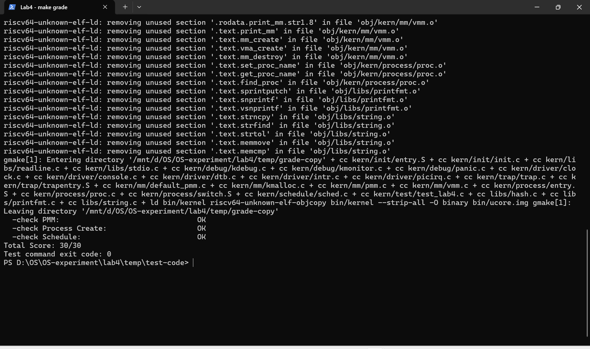
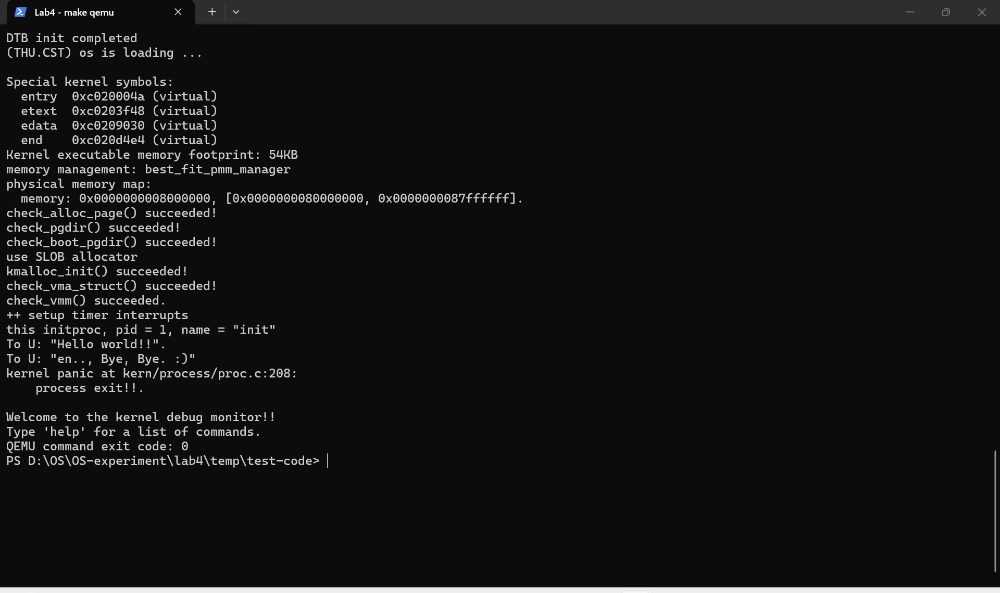

# 实验报告

## 实验基本信息

| 项目 | 内容 |
|------|------|
| 实验名称 | Lab 4：进程管理 |
| 小组成员 | 2512075-詹力臻、2511440-张博翔、2511794-宋昕睿 |
| 完成日期 | 2026-11-12 |

### 小组分工

| 成员 | 负责的内容 |
|------|------------|
| 2511440-张博翔 | Lab 2、Lab 3 代码接入；功能模块一：虚拟内存页操作；页表思考题 |
| 2512075-詹力臻 | 功能模块二：进程创建与初始化 |
| 2511794-宋昕睿 | 功能模块三：进程调度；中断控制思考题；测试与报告整合 |

报告按上述分工整理各部分，再统一检查和整合。

## 一、实验目的

1. 理解虚拟地址与物理页的映射关系，掌握建立、替换和删除映射时的引用计数处理。
2. 理解进程控制块、内核栈、Trap frame 和上下文在创建内核线程时各自的作用。
3. 理解调度器如何选择可运行线程，以及线程第一次运行和之后切换的路径。
4. 使用提示词辅助完成代码，并通过运行、测试和检查分析结果。

## 二、实验环境

- 系统：Windows 下的 WSL，发行版为 ReductWSL。
- 工具链：SiFive RISC-V GCC / GDB 交叉工具链。
- 模拟器及固件：QEMU 4.1.1，OpenSBI v0.4。
- 源码目录：`lab4/code`。测试在该目录的临时副本中进行。

| 成员 | AI 编程工具 | 底层模型 | 备注 |
|------|------------|----------|------|
| 2511440-张博翔 | Codex | GPT-6 | 小组共同使用 |
| 2512075-詹力臻 | Codex | GPT-6 | 小组共同使用 |
| 2511794-宋昕睿 | Codex | GPT-6 | 小组共同使用 |

## 三、实验整体逻辑分析

Lab 4 的目标是在已有内存管理和 Trap 处理的基础上，让内核创建并运行内核线程。整个过程先准备线程运行所需的地址空间和内存，再创建线程，最后由调度器把 CPU 交给线程。

```text
kern_init
  → pmm_init：初始化物理内存和页表管理
  → pic_init / idt_init：初始化中断处理
  → vmm_init：初始化虚拟内存管理
  → proc_init：准备 idleproc，创建 initproc
  → cpu_idle → schedule → proc_run → switch_to
  → forkret → forkrets → __trapret → kernel_thread_entry → init_main
```

其中 `switch_to` 只切换内核上下文。新线程第一次运行所需的返回现场事先放在自己的内核栈上，所以第一次切换后还需要经过 `forkret` 和 Trap 返回路径，才会到达线程入口。

## 四、实验内容与实现

### 前序实验代码接入

**负责人：** 2511440-张博翔。

依据此前 Lab 2、Lab 3 的代码和提示词接入相关功能。Lab 4 的 `default_pmm.c` 保留了 Best-Fit 测试，但缺少对应管理函数和头文件；因此在该文件的接入位置补上 Best-Fit 管理代码，新增 `best_fit_pmm.h`，并在 `pmm.c` 中选用 `best_fit_pmm_manager`。物理内存初始化继续从设备树取得范围，并根据当前 `struct Page` 的大小安排描述符数组。

Trap 部分将前一实验的恢复现场、中断和异常处理接入现有骨架。Lab 4 原有的 `SAVE_ALL`、`forkrets` 和 Best-Fit 测试函数保留。接入规格见 [前序实验代码接入提示词](prompt/前序实验代码接入_prompt.md)。

### 功能模块一：虚拟内存页操作

**负责人：** 2511440-张博翔。

#### 需要实现的函数

```c
int page_insert(pde_t *pgdir, struct Page *page, uintptr_t la, uint32_t perm);
void page_remove(pde_t *pgdir, uintptr_t la);
```

这两个函数位于 `kern/mm/pmm.c`。`page_insert` 给虚拟地址建立映射；`page_remove` 撤销映射。实现时要同时维护页表、物理页引用计数和 TLB。

#### 提示词和规格

实现前整理的任务要求和检查后补充的边界条件如下，单独文件见 [虚拟页管理提示词](prompt/功能模块一_虚拟页管理_prompt.md)。

````markdown
# 功能模块一：虚拟页管理

[PROMPT]

阅读 `kern/mm/pmm.c`、`pmm.h` 和 `mmu.h`，在 Lab 4 标记处实现 `page_insert` 与 `page_remove`，保留标记并按分工填写学号 `2511440`。

[RELY]

`get_pte` 可按虚拟地址查找页表项，并在 `create` 为真时分配缺失的中间页表。使用已有的 `pte_create`、`pte2page`、引用计数和页面分配接口，以及 `tlb_invalidate`。

[GUARANTEE]

实现接口 `int page_insert(pde_t *, struct Page *, uintptr_t, uint32_t)` 和 `void page_remove(pde_t *, uintptr_t)`，不修改课程提供的测试函数。

[SPECIFICATION]

- 输入页目录、目标页、虚拟地址和权限；成功后页表指向指定页，返回 0。

- 利用 `get_pte` 查找或创建页表项，根据 Sv39 页表项格式写入物理页号和权限。
- 处理新建映射、替换不同物理页、对同一物理页更新权限以及删除不存在的映射，正确维护引用计数。
- 引用数归零时释放物理页，页表项变化后刷新 TLB；分配页表失败时返回错误并清理本次新增的页表页。
- 上级页表项已经是大页叶子项时，不把它当成下一级页表使用；不在本任务中拆分大页。
- 删除没有映射的地址应直接返回；用原有测试检查结果，并说明测试范围。
````

#### 实现过程与结果

1. `page_insert` 先用 `get_pte` 查找或创建页表项。若该位置原来没有映射，就增加新物理页的引用计数。
2. 如果原来映射到另一页，先清除旧映射并刷新 TLB；旧页引用数减为 0 时释放，再增加新页的引用数。如果原来就是同一页，只更新权限，不改变引用数，避免误释放。
3. 写入新页表项后再次刷新对应地址的 TLB。Sv39 的叶子项需要读或执行权限，且有写权限时必须同时具有读权限，因此对这两种情况补上必要的 `PTE_R`；同时设置访问和脏位。
4. 如果新建中间页表时第二次分配失败，清除并释放本次刚建立的上一级页表页，返回 `-E_NO_MEM`。`page_remove` 对未映射地址直接返回；有映射时清除页表项、刷新 TLB，并在引用数归零时释放页面。
5. 复核发现启动页表上级条目可能直接映射大页，而骨架的 `get_pte` 会将其当成下一级页表。现在先识别上级叶子项：查找时返回空，插入时返回 `-E_INVAL`，避免错误地修改大页对应的物理内存；本实验不拆分大页。

课程测试检查了新建、替换、重复映射和重复删除；另在临时副本中测试了中间页表分配失败时的回收和已有大页的保护，结果通过。现有 `get_pte` 主要按普通 4 KiB 页表逐级查找，并未实现对已有大页叶子项的拆分，不能把它当作完整的大页管理接口。

### 功能模块二：进程创建与初始化

**负责人：** 2512075-詹力臻。

#### 需要实现的函数

```c
static struct proc_struct *alloc_proc(void);
void proc_init(void);
int kernel_thread(int (*fn)(void *), void *arg, uint32_t clone_flags);
int do_fork(uint32_t clone_flags, uintptr_t stack, struct trapframe *tf);
static void copy_thread(struct proc_struct *proc, uintptr_t stack, struct trapframe *tf);
static int copy_mm(uint32_t clone_flags, struct proc_struct *proc);
```

这些函数位于 `kern/process/proc.c`，一起完成 PCB 初始化、内核线程创建和线程首次运行现场的准备。

#### 提示词和规格

任务要求与检查后补充的边界条件如下，单独文件见 [进程创建提示词](prompt/功能模块二_进程创建_prompt.md)。

````markdown
# 功能模块二：进程创建

[PROMPT]

阅读 `kern/process/proc.c`、`proc.h`、进程入口和中断返回代码，在 Lab 4 标记处实现内核线程创建与初始化，按分工填写学号 `2512075`。

[RELY]

沿用 `struct proc_struct`、`struct context`、`struct trapframe`、进程链表与哈希表，以及 `kmalloc`、内核栈分配、`get_pid`、`wakeup_proc`、`forkret` 和 `forkrets` 等接口。

[GUARANTEE]

完成 `alloc_proc`、`proc_init`、`kernel_thread`、`do_fork`、`copy_thread` 和 `copy_mm`，保留接口签名。

[SPECIFICATION]

- 完成进程控制块初始化、内核栈分配、`copy_mm`、`copy_thread`、`do_fork`、`kernel_thread` 和 `proc_init`。
- 正确设置父进程、PID、链表、初始上下文与 trapframe，并处理分配失败后的清理。
- 本实验先支持共享内核地址空间的内核线程，不把占位的 `copy_mm` 描述为已经支持用户进程地址空间复制。
- PCB 初始状态为 `PROC_UNINIT`，PID 尚未分配；创建成功返回新 PID，分配失败返回负错误码。
- `idleproc` 使用当前启动栈并成为 `current`；`initproc` 由 `kernel_thread` 创建，并进入进程表。
- 新线程第一次运行时，经 `forkret`、`forkrets` 和 `__trapret` 恢复预设现场；未支持的用户地址空间复制应返回错误。
- 使用课程提供的检查程序验证进程创建过程。
````

#### 实现过程与结果

`alloc_proc` 分配并清零 PCB，将状态设为 `PROC_UNINIT`、PID 设为 -1，填写启动页目录并初始化链表节点。`proc_init` 先建立进程链表和哈希表，把当前执行现场设置为 PID 0 的 `idleproc`，再通过 `kernel_thread` 创建 `initproc`。

`kernel_thread` 把线程函数和参数放进临时 Trap frame 的 `s0`、`s1`，把入口设为 `kernel_thread_entry`，再调用 `do_fork`。`do_fork` 依次分配 PCB 和内核栈、处理地址空间、准备线程现场，最后分配 PID、登记到链表和哈希表并唤醒。分配内核栈或后续步骤失败时，释放已经取得的资源。

`copy_thread` 把 Trap frame 放到新线程内核栈顶部附近，并将新线程的 `context.ra` 设为 `forkret`、`context.sp` 设为该 Trap frame。之后第一次被调度时，通过返回路径进入线程函数。`copy_mm` 在本实验只保留内核线程需要的接口；检查时发现对未支持的用户地址空间不能直接返回成功，因此增加了错误返回。用户进程地址空间复制仍未实现。

课程进程创建测试通过，检查了 `idleproc` 和 `initproc` 的状态、PID、父子关系和首次运行所需的上下文。

### 功能模块三：进程调度

**负责人：** 2511794-宋昕睿。

#### 需要实现的函数

```c
void cpu_idle(void);                                  // kern/process/proc.c
void schedule(void);                                  // kern/schedule/sched.c
void proc_run(struct proc_struct *proc);              // kern/process/proc.c
void switch_to(struct context *from, struct context *to); // kern/process/switch.S
```

本模块负责从可运行线程中选择下一个线程，并保存和恢复上下文。

#### 提示词和规格

任务要求与检查后补充的边界条件如下，单独文件见 [进程调度提示词](prompt/功能模块三_进程调度_prompt.md)。

````markdown
# 功能模块三：进程调度

[PROMPT]

阅读进程控制块与调度接口，实现 `cpu_idle`、`schedule`、`proc_run` 和 `switch_to`，按分工填写学号 `2511794`。

[RELY]

使用 `proc_list`、`current`、`idleproc`、`PROC_RUNNABLE`、`need_resched` 和 `runs`；`struct context` 包含 `ra`、`sp` 和 `s0` 至 `s11`。使用 `local_intr_save`、`local_intr_restore`、`SATP_MODE_SV39` 和 `flush_tlb`。

[GUARANTEE]

完成 `cpu_idle`、`schedule`、`proc_run` 和 `switch_to`，保持现有接口。`cpu_idle` 放在 `kern/process/proc.c`，调度选择放在 `kern/schedule/sched.c`，寄存器切换放在 `kern/process/switch.S`。

[SPECIFICATION]

- 遍历进程链表寻找可运行进程，没有可运行进程时回退到 idle 进程。
- 在本地中断保护下切换 `current`，按已有 Sv39 页表接口切换地址空间并刷新 TLB。
- 汇编部分保存和恢复 `struct context` 中的 `ra`、`sp`、`s0` 至 `s11`，使执行流能够恢复。
- `cpu_idle` 仅在需要重新调度时调用 `schedule`；切换到当前线程自身时无需执行上下文切换。
- 使用课程提供的检查程序验证线程创建、轮转和上下文切换；报告如实记录运行结果。
````

#### 实现过程与结果

`cpu_idle` 在循环中检查 `current->need_resched`，需要调度时调用 `schedule`。`schedule` 从当前线程之后遍历进程链表，选择下一个 `PROC_RUNNABLE` 的线程；没有可运行线程时选择 `idleproc`，并记录被选中线程的运行次数。

`proc_run` 在切换目标不是当前线程时，先保存并关闭本地中断，再更新 `current`、写入目标线程的 Sv39 页表并刷新 TLB，最后调用 `switch_to`。`switch_to` 按 `struct context` 的布局保存旧线程的 `ra`、`sp`、`s0` 至 `s11`，从新线程的上下文恢复这些寄存器，再由 `ret` 继续执行。旧线程以后被切回时，才会从原先的 `switch_to` 调用处继续执行并恢复中断状态。

实现后对照指导书检查，发现 `cpu_idle` 的位置应为 `proc.c`，已移回该文件。课程调度测试创建了两个测试线程，主动调度多次并检查两个线程均执行过，结果通过。该测试证明了所覆盖场景下的轮转和上下文切换，不等同于已经完成抢占式时间片调度。

### Challenge：本地中断控制

**负责人：** 2511794-宋昕睿。

`local_intr_save(intr_flag)` 会检查当前 `sstatus` 的 SIE 位：如果原来开着中断，就先关闭并把 `intr_flag` 记为真；如果原来已经关闭，就记为假。执行临界区后，`local_intr_restore(intr_flag)` 只在原来开启的情况下重新开启中断。因此，嵌套使用时不会把外层已经关闭的中断提前打开。

这里保护的是当前处理器上的中断状态，能够防止本地中断打断相关操作；它本身不能阻止其他 CPU 同时访问共享数据，多核情况下还需要锁等同步机制。

### Challenge：不同页表模式与 `get_pte`

**负责人：** 2511440-张博翔。

Sv32、Sv39、Sv48 都把虚拟地址拆成多个页表索引和页内偏移，查询时逐级读取页表项。以 4 KiB 页为例，页内偏移都是 12 位；Sv32 用两级索引，每级 10 位；Sv39 用三级索引，每级 9 位；Sv48 用四级索引，每级 9 位。Sv39、Sv48 的有效虚拟地址还需要满足高位符号扩展的规定。

本实验的 `get_pte` 在到达最终页表项前，需要依次检查两级中间页表。每一级做的事相似：检查当前目录项是否有效；不存在时根据 `create` 决定返回还是分配、清零新页表；再通过物理地址找到下一张表。因此两段代码形式相近，只是使用的索引层级不同。

把查找和分配放在一个函数里，调用方便，参数 `create` 能区分“只查找”和“缺失时创建”。代价是函数有时会改变页表，失败后也要考虑部分分配的清理。若后续实现更复杂的缺页处理、大页或并发访问，可以拆成只查找和负责创建的接口，让副作用和资源回收责任更清楚；在当前规模下，保留合并接口也可以，但要明确失败时的行为。

## 五、测试与验证

在源码临时副本运行课程提供的 `make grade`，结果为：

```text
check PMM:             OK
check Process Create:  OK
check Schedule:        OK
Total Score: 30/30
```



另外在临时副本测试 `page_insert` 的内存不足分支：保留一页空闲内存，使第一级页表分配成功而下一次分配失败；确认函数返回错误、物理页引用数不变、临时页表页回收，输出 `[Test page_insert OOM rollback] PASS`。还针对内核已有的大页检查了查找、插入和删除，确认不会破坏大页映射，输出 `[Test superpage guard] PASS`。测试代码未加入正式源码。

普通 `make qemu` 运行中，Best-Fit、页目录、启动页表、堆分配器和 VMM 自检均输出成功，随后运行到 `initproc` 并打印 `Hello world!!`。实际终端截图如下：



截图中 `init_main` 返回后出现 `process exit!!` panic，是因为课程骨架的 `do_exit` 当前仍是 panic 占位。本次练习没有要求实现完整的进程退出和回收，因此保留该行为；`make grade` 的 30/30 只说明上述三项评分检查通过，不代表退出流程已完成。终端显示的 QEMU 进程退出码也不能单独证明内核无 panic。

编译时，骨架 `kmalloc.c` 中有一次整数地址传给 `kva2page` 的类型警告；评分注入的测试线程函数与 `kernel_thread` 参数类型也有警告。它们没有阻止本次编译和评分，测试函数保持原样。

此外，骨架的 `get_pte` 给中间页表项设置了 `PTE_U`，其自检也依赖这个标志；按 [RISC-V 特权架构规范](https://docs.riscv.org/reference/isa/priv/supervisor.html)，非叶子页表项中的 U、A、D 位属于保留位。为保持课程骨架自检不变，本次保留了现状，所以结果只验证了当前 QEMU 4.1.1 环境，移植到严格检查这些位的实现时需要一并调整代码和相关自检。

## 六、实验总结与收获

### 对操作系统的理解

1. **页表和物理页。** 页表项记录虚拟页到物理页的映射；`struct Page` 维护物理页的管理信息。多个虚拟地址可以映射到同一物理页，因此删除一个映射不一定能释放该页。
2. **PCB 和执行现场。** PCB 保存线程的状态和资源信息；内核栈上的 Trap frame 保存 Trap 返回现场；`context` 保存内核调度切换时需要恢复的寄存器，三者的作用不同。
3. **进程创建与调度。** 创建线程只是准备资源和现场，调度器选择它之后才会真正运行。首次运行经过 `forkret` 和 Trap 返回路径，之后的线程切换从此前保存的 `context` 恢复。
4. **临界区。** 保存和恢复本地中断状态能避免当前 CPU 上的中断打断关键操作，但不提供跨 CPU 的互斥。

本实验尚未完成用户地址空间复制、完整的进程退出与资源回收，也没有实现完整的多核同步和抢占式时间片调度；这些仍需要后续实验处理。

### AI 协作开发的经验

写提示词时，需要把现有接口、可修改范围和失败条件说明白。生成代码后还要对照骨架检查函数位置、调用约定和资源释放，再用测试确认；测试通过也要结合实际运行输出来看没有覆盖到的部分。
